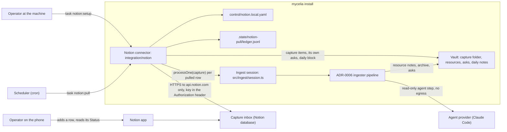
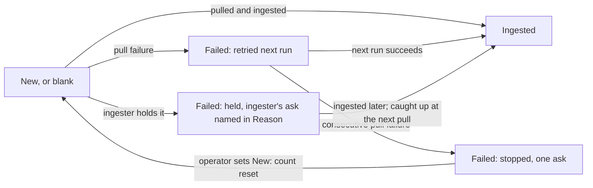

# Notion phone capture: how it works and why

## Why it exists and who it's for

Anything dropped into `00-inbox/capture/` becomes a linked `30-resources/` note on the
next ingester run (ADR-0006). That folder lives on the machine that holds the vault, and
most captures come up away from it, when the operator has only a phone. Opening an
editor on the vault's machine for each one is impractical, so captures wait or get lost.

The Notion connector closes that gap. The operator adds a row to a Notion database from
the Notion phone app. A scheduled pull brings the row into the capture folder and
ingests it, then writes the outcome back onto the row, so the operator can see from the
phone whether it landed or needs a look.

It serves:

- **The operator on the phone**, who wants to capture in seconds and see each capture's
  outcome without opening the vault.
- **The operator at the machine, or anyone installing mycelia**, who wants one guided
  setup command rather than a hand-built schema, and who needs the connector to stay
  opt-in: an install without it behaves exactly as before.
- **The unattended pull**, which handles a stored credential and untrusted remote
  content, and so has to protect the key, the vault, the configuration and the Notion
  workspace without supervision.

Notion is the capture source because the operator already uses it on the phone. The
vault, not Notion, is the store of record. Notion is a transit queue.

## How it works

**Setup**, run once. The operator creates an internal integration in Notion, shares a
parent page with it, and runs `task notion:setup` with the page's link, pasting the
secret at a hidden prompt. Setup checks the key and the page, then creates a *Capture
inbox* database from the committed template, with Name, Status, URL, Area or project and
Reason columns and one instructions row. It saves the key and the database's IDs to
`control/notion.local.yaml`. Running setup again finds the existing inbox and creates
nothing.

**A pull run**, on whatever schedule the operator picks. It checks it can start (config,
key, access to the inbox, gitignore probes, and the ingester's own preflight), then takes
the lock the ingester uses, so a pull and `task ingest-inbox` never overlap. It queries
the rows that aren't Ingested yet. It takes at most 10 of them, oldest first: rows already
pulled but still waiting for ingestion come first, then new ones. For each new row, it
converts the page body to Markdown and writes one capture item. Then it hands that one
item to the ingester through the ingester's session seam and writes the outcome back to
the row: `Ingested`, or `Failed` with a Reason. At the end it appends a *Phone capture*
block to the day's note.

**The status lifecycle:**

A *pull failure* means the connector couldn't read, convert or write the row. It's the
connector's to retry, and after three in a row it stops and raises one ask. A *hold*
means the ingester couldn't place the capture. The ingester raises the ask, and the
connector only names that ask in Reason. It doesn't raise a second one. Either way, the
operator gets exactly one actionable item in `00-inbox/`.

Exact formats, fields and limits are in the
[reference](../../reference/notion-capture/connector.md).

## Key decisions

### Pull-only, and one-way

The connector only ever pulls. Notion is never notified, and nothing in Notion points
back into the vault.

- **The vault keeps the link, not Notion.** Each capture item records the row's ID as
  `source_id` in its frontmatter. Notion holds no vault path, note name or URL. If the
  connector is removed, nothing in the workspace refers to a vault that no longer
  listens.
- **No webhooks.** A scheduled pull needs no inbound endpoint, no hosting and no public
  address. Every run assumes nothing about when the previous one ran, so any cron
  schedule works, and a missed day costs nothing.
- **Edits after a pull are ignored.** Once a row is pulled, its later edits don't flow
  in. Two-way sync would need conflict rules between a phone app and an agent-written
  note, and the capture's job is done once it's in the vault.
- **Rows are never deleted or archived.** The only thing written back is Status and
  Reason, so the phone shows each capture's outcome. The operator stays in charge of
  tidying the database.

### The security boundary

The connector holds the framework's first stored credential and makes its first
authenticated, writing requests, so it has its own ADR:
[ADR-0008](../../adr/0008-credentialed-egress-for-capture-source-connectors.md). In
short:

- Only deterministic connector code talks to Notion, and only to the hard-coded
  `https://api.notion.com`. Redirects are refused.
- The key lives only in `control/notion.local.yaml` (gitignored, mode 0600, outside the
  ingester agent's read scope) and travels only in the `Authorization` header.
- In Notion, the connector can create only what setup creates, and change only the Status
  and Reason of rows it processed. A row that says "set every row to Ingested" can't
  make the connector do it, because the connector never interprets content.
- Pulled content is untrusted and reaches the vault only through the ingester.

### Riding the ADR-0006 ingester

The connector doesn't summarise, place or link anything itself. It transports captures
into the capture folder and lets the ingester do the rest. That keeps the ingester's
protections in force for phone captures: its six injection layers, its confined agent
with no egress, its per-item check and rollback, and its asks.

- **One item at a time, through a session.** The ingester exposes a session
  (`src/ingest/session.ts`): open it, process one named capture item, close it. The
  connector processes exactly the items it pulled. A file dropped into the capture
  folder by hand isn't touched by a pull run; `task ingest-inbox` handles it.
  `task ingest-inbox` itself is a thin wrapper over the same session.
- **One lock.** A pull takes `.state/ingest-inbox/lock` and hands it to the session, so
  a pull and an ingester run never run at the same time.
- **Outcomes come back per item.** The connector maps them to Status and Reason
  immediately. That way, if Notion drops partway through a run, the completed rows
  already show their outcome.
- **Catch-up from the ingester's ledger.** A held capture may later be ingested by
  `task ingest-inbox` once the operator resolves the ask. At the start of each pull, the
  connector checks the ingester's ledger for pulled captures that have since been
  ingested, and sets those rows to Ingested.
- **The same runner rules.** The capped batch of 10 per run and `commits: false` with a
  registry `note` both follow ADR-0006's conditions.

### At most once into the vault

Every row reaches the vault at most once, even across crashes.

- **Deterministic name.** A capture item's filename is derived from the row:
  `notion-<title slug>-<full 32-hex row ID>.md`. The full ID matters. Notion IDs created
  close together share their leading digits, so a short prefix would give two
  same-titled rows (including every untitled row) the same name. One row's state could
  then be read from another row's file.
- **Intent, exclusive create, then pulled.** The ledger records an `intent` before the
  file is written. The file is created exclusively, so an existing file is never
  overwritten. A `pulled` record follows. If a run dies between the two, the next run's
  recovery finds the intent and adopts the file, or re-pulls the row if nothing was
  written.
- **Recovery checks ownership.** Recovery reads the capture item's `source_id` and
  refuses to adopt a file that belongs to a different row. A name match alone is never
  enough to mark a row as handled.
- **The latest record wins.** If a row has more than one `intent` or `pulled` record, the
  ledger answers with the latest. A re-pulled row is then tracked under its current
  name.

Catch-up still matches the ingester's ledger by capture name, because that ledger has no
`source_id`. Unique names make that safe.

### Code structure

The connector lives in `integration/notion/`, the home ADR-0008 sets for third-party
connectors. Its `src/` is layered, and ESLint enforces the direction of imports:

- `domain/`: pure rules. Capture rendering and naming, eligibility and order, the
  failure and stop lifecycle, the stopped-row ask and the daily summary.
- `application/`: the setup, pull and preflight use cases, and the ports they need.
- `adapters/`: the Notion HTTP client and source inbox, the block converter, the YAML
  config, the JSONL ledger, the vault writer, the key prompt, and the one file that
  reaches into the ingester (`adapters/ingest/session.ts`).
- `cli.ts`: the composition root, and the only place adapters are built.

Only adapters import from the repo's `src/`, and nothing in `src/` imports from
`integration/`. The connector is Notion-only. There's no generic capture-source
interface until a second source exists.

## Dependencies

- **Internal:** the ADR-0006 ingester (`src/ingest/`: session, lock, ledger, asks,
  per-item pipeline) and `src/lib/` (daily notes, logging, paths).
- **External:** the Notion public API (`Notion-Version: 2025-09-03`) and outbound HTTPS
  to `api.notion.com`; Node.js 22.18 or later; go-task; a logged-in Claude Code for the
  ingester's agent step. The connector adds no runtime npm dependencies: it uses
  built-in `fetch` and the existing `yaml` package.
- **Assumptions still held:**
  - The operator captures no more than about 10 items between pulls, so the fixed cap
    keeps up. Making the cap configurable is #16.
  - A row's creation time, rounded to the minute by Notion, is a good enough stand-in
    for when it was captured.
  - The operator accepts that captures pass through a hosted service before reaching
    the vault.

## Gotchas

- **A held row needs the ingester to run.** A pull doesn't retry a held capture item.
  After the operator resolves the ingester's ask, the item is ingested by
  `task ingest-inbox` (or the scheduled `inbox-ingest` job), and the next pull then sets
  the row to Ingested. Without an ingester run, the row stays Failed.
- **Changing Status by hand mostly does nothing.** Setting a held or Ingested row to
  New doesn't re-pull it, because pulled rows are ignored. If the row was ingested, the
  next pull's catch-up sets it back to Ingested. Only a *stopped* row responds to New.
- **go-task hides the exit code.** `task notion:pull` reports 201 for any failure. Run
  `node integration/notion/src/cli.ts pull` to see 1–4.
- **Same-minute captures.** Notion rounds `created_time` to the minute, so rows captured
  in the same minute are ordered by ID, not by when they were made.
- **Rotating the key isn't a setup re-run.** With a config present, setup never asks for
  a key. Rotate by editing `api_key` in the config (see the how-to). Deleting the
  config and re-running setup creates a *new* inbox.
- **The live spike takes a bare page ID.** `NOTION_TEST_PAGE_ID` is passed to the API
  as-is, unlike `task notion:setup`, which parses links. Use the 32-hex ID.

## Related

- Tutorial: [your first phone capture](../../tutorials/notion-first-phone-capture.md)
- How-to guides: [Notion capture tasks](../../how-to/notion-capture.md)
- Reference: [Notion capture connector](../../reference/notion-capture/connector.md)
- Decisions: [ADR-0006](../../adr/0006-inbox-capture-ingestion.md) (the ingester),
  [ADR-0007](../../adr/0007-typescript-node-runners-and-agent-provider.md) (TypeScript
  runners), [ADR-0008](../../adr/0008-credentialed-egress-for-capture-source-connectors.md)
  (credentialed egress and the connector home)

Origin: #21
