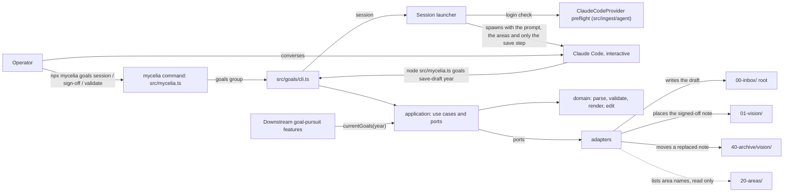
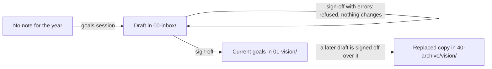

# Year goals: how they work and why

## Why it exists and who it's for

Mycelia's agents grow the operator's vault, but on their own they don't know what the
operator is trying to achieve this year. Without stated goals they can only grow the
vault evenly, which the project anchor lists as a non-goal. Year goals are the input the
goal-pursuit layer steers by: linking goals to notes (#37), quarterly focus (#38),
goal-aware prioritisation (#39), in-quarter guidance (#40), the quarterly retro (#41)
and the year review (#42).

Goals live only here, in the vision layer. Areas in `20-areas/` hold the knowledge that
accumulates over the year, not the operator's state or goals. A goal may name the areas
it touches, but only as places where knowledge about it will build up. Nothing about a
goal is written into an area note.

It serves:

- **The operator, before or early in each year**, who sets the year's goals in a guided
  conversation instead of writing the structure by hand.
- **The operator at any later point**, for whom nothing counts as the year's goals until
  they sign it off.
- **Downstream goal-pursuit agents**, which need one dependable, machine-readable
  statement of the year's signed-off goals and their later changes, so they can steer
  without asking.
- **Anyone installing mycelia**, who gets the format, a template and the `01-vision/`
  folder with the framework, while their own goals never enter the framework repository.

## The shape of a year's goals

Each year has one **year-goals note**. It holds:

- One or more **main goals**, each drafted as a **Mandala Chart**: a centre goal, up to
  8 pillars that serve it, and up to 8 actions under each pillar. A partly filled chart
  is valid and is the normal case at the first sitting. Most years have one main goal.
  More than 3 is allowed but strongly discouraged.
- A short list of **secondary goals**: one line each, with no chart. A goal worth
  charting is a main goal, and anything lighter is a secondary goal.
- The **areas** each pillar or secondary goal touches, as `[[wikilinks]]`.
- A **status**, `draft` or `signed-off`, and a dated **changes** section that records
  what happened during the year, such as a goal achieved early or abandoned.

The format deliberately doesn't confine how the operator breaks a goal down. A
breakdown into sub-goals or quarterly goals, or any other extra content, stays in the
note and is ignored by the parser. The validator follows the same principle. It reports
**errors** only for content that makes the note unreadable, and every rule about how the
goals are structured (more than 3 main goals, more than 8 pillars or actions, a main goal
with no pillars, an area with no note) is a **warning** that never rejects the note.

The exact layout, frontmatter, errors, warnings, commands and exit codes are in the
[format reference](../../reference/year-goals/format.md).

## How it works

**The session.** The operator runs `npx mycelia goals session 2027`. The launcher checks
the year and that Claude Code is installed and logged in, checks that the paths it may
write are gitignored, and lists the existing areas. It refuses if the year already has a
draft in the inbox, unless `--continue` is given, which starts from that draft and
rewrites it. Then it starts interactive Claude Code with a committed prompt. The agent
asks, for each main goal in turn, for the centre goal, the pillars, each pillar's
actions and each pillar's areas, offering the existing areas by name. Then it asks for
secondary goals.

**Saving.** After each agreed step, the agent passes the whole draft so far, as
structured JSON, to `save-draft`. That command checks the shape, renders the note and
writes `00-inbox/<year>-goals.md` with `status: draft`. Stopping early keeps the last
saved step. The draft sits in the inbox root, not in `00-inbox/capture/`, so the inbox
ingester never touches it. When Claude Code exits, the launcher validates the draft and
prints the sign-off command.

**Review and sign-off.** The operator reviews the draft, edits it by hand if they want,
and runs `npx mycelia goals sign-off 2027`. Sign-off refuses on any error and changes
nothing. Otherwise it sets `status: signed-off` and the sign-off date, and moves the
note to `01-vision/<year>-goals.md`, which makes it the year's **current goals**.

**Signing off again.** If the year already has current goals, a new draft can be signed
off over them. The earlier note moves, byte for byte, to
`40-archive/vision/<year>-goals-replaced-<date>.md`. Its changes entries are carried
into the new note, and one dated entry records the update. History is kept, not
overwritten.

**The lifecycle of a note:**

**Reading the goals.** Downstream features don't read files directly. They call
`currentGoals(year)` in `src/goals/application/`, which reads only `01-vision/` and
returns the parsed goals, or "none" with a reason. A draft is never anyone's goals.

## Key decisions

### A launched, confined conversation

The session is interactive Claude Code started by a TypeScript launcher, not a call
through the `AgentProvider` seam, which is one-shot. The launcher limits the agent to
the Bash tool with one allowed command, the save step, in `dontAsk` mode with no user
settings and no MCP servers. Every other write is denied without a prompt. Read-only
commands inside the repository are still allowed. The reasons, the flags and their
observed behaviour are in
[ADR-0009](../../adr/0009-interactive-goal-setting-session-outside-the-agent-provider-seam.md).

### A structured save step, not a file-writing agent

The agent never writes Markdown itself. It passes a structured draft to `save-draft`,
and tested code renders the note. So every saved draft passes the validator by
construction, the only write path is code, and an early stop can't leave a broken note.
The agent can't add free-form extras, but the operator can, by editing the draft.

### Sign-off is a separate, deterministic command

Drafting goals and committing to them are separate acts. Sign-off is code, not the
agent, so the moves, the archive copy and the merge of changes entries are tested
without a model. It writes in a fixed order: the new note to a temporary file in
`01-vision/`, a copy of the earlier note to the archive, the temporary file renamed into
place, then the inbox draft removed. At every point the earlier note is either current
or archived, and re-running sign-off after a crash loses nothing. An archive name
already taken by an identical copy is reused, and one taken by different content gets
the next free `-2`, `-3` … suffix.

### Headings and lists, not a grid

A Mandala Chart is written as headings and lists (`## Main goal:`, `### Pillar:`, list
items for actions), not as a 9 × 9 table or in YAML frontmatter. It reads as text in any
Markdown preview, including Obsidian with no plugins, a partly filled chart looks
natural, and extra content fits around it. The cost is that it doesn't look like the
grid.

### One runtime command

The goal commands are the `goals` group of the one `mycelia` command, not Taskfile
targets. Taskfile is for installation only
([ADR-0010](../../adr/0010-taskfile-install-only-and-the-mycelia-command.md)).

### Goals stay local

`01-vision/` ships with only its README. `.gitignore` keeps everything else in it out of
git, as it does for the inbox and the archive. Every command also refuses to write a path
that `git check-ignore` doesn't report as ignored. A year-goals note is the operator's
own material, whether draft, signed off or archived.

### Code structure

The code lives in `src/goals/`, layered like the Notion connector, and ESLint enforces
the direction of imports:

- `domain/`: pure. The `YearGoals` model, `parse`, `validate`, the draft renderer and
  the text-preserving edits that sign-off makes. No I/O. The known areas are passed in.
- `application/`: the use cases (`validateNote`, `currentGoals`, `saveDraft`, `signOff`)
  and their ports (`VisionVault`, `AreaIndex`, `IgnoreProbe`, `Clock`, `NoteReader`).
  `VisionVault` can reach only the inbox draft, the current note and the archive.
  `NoteReader` reads the one arbitrary path `validate` is given.
- `adapters/`: the filesystem vault, the area index (it lists the `20-areas/*.md` stems,
  except the README), the gitignore probe, the clock, the note reader and the session
  launcher.
- `cli.ts`: the `goals` group's composition root, and the only place adapters are built.
- `session-prompt.txt`: the committed prompt. It's a `.txt` because no `.md` file is
  committed under `src/` (ADR-0007).

Downstream features import the domain types and `currentGoals`, and add their own
`mycelia` groups.

## Dependencies

- **Internal:** `src/ingest/agent/` (`ClaudeCodeProvider.preflight()` for the login
  check) and `src/lib/claude-bin.ts` (resolving `claude`). The vault's `.gitignore`, which
  keeps the content of `00-inbox/`, `01-vision/` and `40-archive/` local.
- **External:** Node.js 22.18 or later; the `yaml` and `zod` packages already pinned by
  ADR-0007; a logged-in Claude Code CLI for the session only. Validate and sign-off need
  no model.
- **Assumptions still held:**
  - The operator sets goals for one year at a time, before or early in that year.
  - A partly filled chart is the normal case at the first sitting.
  - Most years hold one to three main goals.
  - A short list is enough structure for secondary goals.
  - Area notes are named by their filename stem, so an area link can be checked against
    a file's existence.

## Gotchas

- **A mistyped heading drops a goal silently.** `## Main gaol: …` is read as extra
  content. `mycelia goals validate` prints a summary of what it found, so check the
  counts.
- **`--continue` rewrites the draft.** The agent starts from the existing draft, but
  every save renders the note from structured input. Content the structured draft can't
  hold, such as a hand-written quarterly breakdown, is lost. Add extras after the
  session.
- **The example assumes the default areas.** The committed example uses only the area
  slugs from `control/areas.example.yaml`. Validating it in a vault without one of those
  areas gives a warning.
- **An archived note's `name:` doesn't match its file name.** A replaced note keeps
  `name: <year>-goals` in `40-archive/vision/<year>-goals-replaced-<date>.md`, byte for
  byte. That's an accepted exception, so `[[2027-goals]]` still points at the current
  note.
- **Sign-off reads the inbox draft only.** Editing `01-vision/<year>-goals.md` by hand
  doesn't go through sign-off, and a hand-edited current note with errors makes
  `currentGoals` return none, with a reason.
- **The session depends on Claude Code's flags.** After a Claude Code upgrade, re-check
  the tool limits recorded in the header of `src/goals/adapters/session.ts`
  (see ADR-0009's revisit conditions).
- **There's no amendment flow yet.** Recording a change during the year means editing
  the changes section of a draft and signing it off again, or editing by hand. An
  agent-guided amendment flow is #46.

## Related

- Reference: [year-goals note format](../../reference/year-goals/format.md),
  [template](../../reference/year-goals/template.md),
  [example](../../reference/year-goals/example-2027-goals.md),
  [the `mycelia` command](../../reference/mycelia-command.md)
- Decisions: [ADR-0009](../../adr/0009-interactive-goal-setting-session-outside-the-agent-provider-seam.md)
  (the launched session), [ADR-0010](../../adr/0010-taskfile-install-only-and-the-mycelia-command.md)
  (the `mycelia` command), [ADR-0007](../../adr/0007-typescript-node-runners-and-agent-provider.md)
  (TypeScript runners and the provider seam)

Origin: #36
