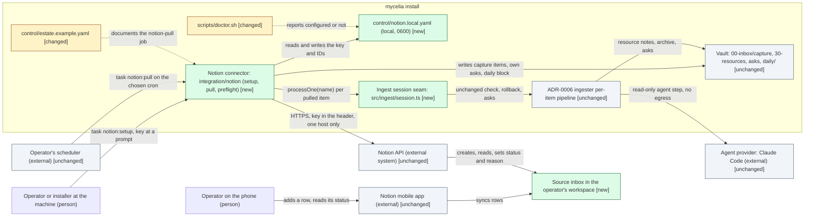
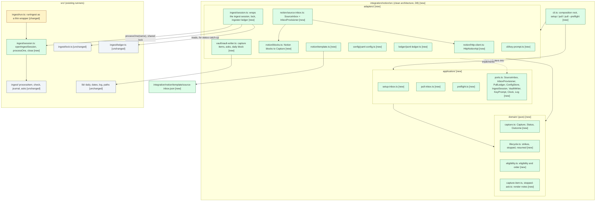
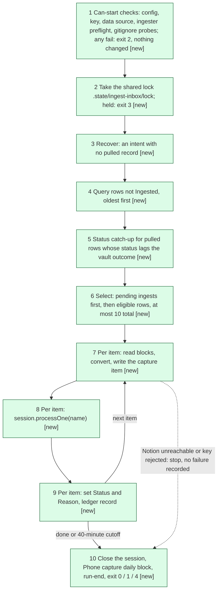
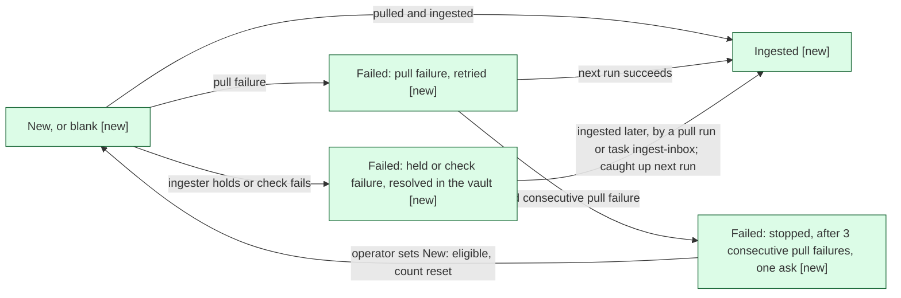

# Design: Notion inbox: capture from phone into the vault inbox

> Phase: Design | Started: 2026-10-10 | Status: Approved (Design complete 2026-10-12)
> Requirements: [`define/index.md`](../define/index.md) · Session history: [`log.md`](../log.md)

## Contents

This design has one file. The primary kind (Plugin/tooling) has no in-depth path yet, so every section is here.

## Prior knowledge

- **Read:**
  - The frozen [`define/`](../define/index.md) and this session's [`log.md`](../log.md).
  - `README.md`, including the anchor, "Inbox ingestion" and "Writing a runner".
  - [ADR-0006](../../../adr/0006-inbox-capture-ingestion.md): capture folder, confined agent, no egress, capped batch, `commits: false`.
  - [ADR-0007](../../../adr/0007-typescript-node-runners-and-agent-provider.md): TypeScript on Node, gates, minimal runtime dependencies, agent-provider seam.
  - `00-inbox/capture/README.md`, `.gitignore`, `control/estate.example.yaml`, `Taskfile.yml`, `package.json`, `tsconfig.json`, `eslint.config.js` and `scripts/doctor.sh`.
  - Code: `src/ingest/` (`cli.ts`, `run.ts`, `capture.ts`, `lock.ts`, `ledger.ts`, `asks.ts`, `fetch.ts`, `agent/provider.ts`) and `src/lib/` (`daily.ts`, `paths.ts`).
- **Not present:** `docs/registry/`, `docs/explanation/` and `docs/reference/`. ADRs live in `docs/adr/`.
- **Not read:** any past session folder, including `docs/sessions/archive/` and the ADR-0006 session that the requirements glossary cites. The ingester's behaviour comes from ADR-0006 and the code.
- **Established stack (stack-defaults check):** the runners are TypeScript on Node ≥22.18 with type stripping, npm with an exact-pinned lockfile, `node:test`, `tsc` strict and ESLint, gated by `task check:node` (signals: `package.json`, `tsconfig.json`, `src/**/*.ts`). The repo has no server framework and no database code. The design builds on that stack and proposes no default.

## Classification

- **Primary kind:** Plugin/tooling. The connector is developer tooling: a CLI runner with `task` entrypoints (REQ-001), a setup command (REQ-002–009), a scheduled pull job (REQ-010–035), a preflight (REQ-036) and a doctor check (REQ-039). It has no UI tier and nothing to host.
- **In-depth path:** none yet. The follow-up is dkoenawan/compass-labs#51; see Open questions.

The operator confirmed both on 2026-10-10.

## Scope checklist

| Area | In scope? | Reason |
|---|---|---|
| Plugin/tooling (runner code) | in | The connector under `integration/notion/` and the ingest-session seam in `src/ingest/` (REQ-001, REQ-010–036) |
| Third-party integration (Notion API and the source-inbox template) | in | REQ-002–011, REQ-022, REQ-044 |
| Security (credential, egress, write set) | in | REQ-004, REQ-005, REQ-008, REQ-024–027 |
| Process/workflow (status lifecycle) | in, lightweight | The New → Ingested / Failed / stopped lifecycle (REQ-015–021) is drawn as a state flow. No separate process design |
| Ops and registry (`estate.example.yaml`, doctor, Taskfile) | in | REQ-001, REQ-037–039 |
| Documentation (README) | in | REQ-042 |
| Frontend | out | The phone UI is Notion's own app (NEED-01) |
| Database | out | The repo has no database. The Notion source inbox is an external schema, designed here under integration (DES-003) |
| Infrastructure | out | Nothing is hosted. The cron entry and the local registry entry are the operator's manual steps (quality.md assumptions) |
| Visual UI design | out | There's no screen to design |

The operator confirmed this checklist on 2026-10-10.

## Context view

*Notation: C4 L1 system context, drawn as a Mermaid `flowchart` with delta styling.*

The ingester's agent still has no network access and can't read `control/` (ADR-0006). The only new egress is the connector's own deterministic code, which talks to one hard-coded API host (D6).

### Component view

*Notation: C4 L3 component view, drawn as a Mermaid `flowchart` with delta styling.*

Dependencies point inward (D8): `domain/` imports nothing outside itself; `application/` imports only `domain/`; `adapters/` import `application/ports.ts` and `domain/`; `cli.ts` wires everything. Only `adapters/` import from `src/` (`../../../../src/ingest/session.ts`, `src/lib/*.ts`), and nothing under `src/` imports from `integration/`. DES-012's lint rule enforces this.

### Pull run

*Notation: process flow, drawn as a Mermaid `flowchart`. Every step is new, part of DES-009.*

### Status lifecycle

*Notation: state flow, drawn as a Mermaid `flowchart` (process/workflow area).*

## Delta list

Each element this design touches has exactly one status. Every visual matches this list.

| Element | Status | DES | Note |
|---|---|---|---|
| `src/ingest/session.ts` (ingest session seam) | new | DES-001 | `openIngestSession` / `processOne` / `close` |
| `src/ingest/run.ts` (`runIngest`) | changed | DES-001 | Becomes a thin wrapper over the session. Same behaviour, exit codes and ledger |
| Ingester per-item pipeline (`processItem`, check, journal, asks, fetch, agent) | unchanged | DES-001 | Called through the session, not copied (REQ-014) |
| `src/ingest/lock.ts` | unchanged | DES-001 | The connector takes the same lock and hands it to the session |
| `src/ingest/ledger.ts` and `.state/ingest-inbox/ledger.jsonl` | unchanged | DES-009 | The connector reads it, for status catch-up (REQ-020) |
| `src/lib/` (daily, dates, log, paths) | unchanged | DES-009 | Reused |
| `integration/notion/src/adapters/notion/{http-client,source-inbox}.ts` | new | DES-002 | |
| `integration/notion/src/application/ports.ts` | new | DES-018 | |
| `integration/notion/src/domain/{capture,lifecycle}.ts` | new | DES-018 | |
| `integration/notion/template/source-inbox.json` | new | DES-003 | |
| `integration/notion/src/adapters/config/yaml-config.ts` and `control/notion.local.yaml` | new | DES-004 | The file is local and gitignored, never committed |
| `integration/notion/src/application/setup-inbox.ts`, `adapters/cli/key-prompt.ts`, `adapters/notion/template.ts` | new | DES-005 | |
| `integration/notion/src/adapters/notion/blocks.ts`, `domain/capture-item.ts` | new | DES-006 | |
| `integration/notion/src/adapters/ledger/jsonl-ledger.ts` and `.state/notion-pull/ledger.jsonl` | new | DES-007 | The ledger file is local |
| `integration/notion/src/domain/eligibility.ts` | new | DES-008 | |
| `integration/notion/src/application/{pull-inbox,preflight}.ts`, `adapters/ingest/session.ts` | new | DES-009 | |
| `integration/notion/src/domain/stopped-ask.ts`, `adapters/vault/vault-writer.ts` | new | DES-010 | |
| `integration/notion/src/cli.ts` (composition root) | new | DES-011 | |
| `Taskfile.yml` | changed | DES-011 | `notion:setup`, `notion:pull`, `notion:pull:preflight` |
| `tsconfig.json`, `package.json` (test script), `eslint.config.js` | changed | DES-012 | Brings `integration/*/` under `task check:node` |
| `scripts/doctor.sh` | changed | DES-013 | New check 9 |
| `control/estate.example.yaml` | changed | DES-014 | `notion-pull` example job |
| `README.md` | changed | DES-015 | "Phone capture (Notion)" section |
| `integration/notion/test/privacy.test.ts` | new | DES-016 | |
| `integration/notion/test/live/spike.live.ts` | new | DES-017 | |
| Source inbox in the operator's workspace | new | DES-005 | Created at runtime by setup, never committed |
| `.gitignore` | unchanged | DES-004 | `control/*.local.yaml` and `.state/` already cover the new local files |
| `00-inbox/capture/` and the rest of the vault | unchanged | DES-009 | Written to, with no change to its structure |
| `.obsidian/app.json` | unchanged | DES-012 | `integration/` holds no `.md` files, so nothing appears in the vault |
| Notion API, Notion app, agent provider, scheduler | unchanged | DES-002 | External |

## Components (DES)

Each item names the `REQ-*` it covers, the result Implement must produce, the check that shows it's done, and the items it depends on. "Connector" files are under `integration/notion/`.

| ID | Component | Covers | Result | Check | Depends on |
|---|---|---|---|---|---|
| DES-001 | Ingest session seam: new `src/ingest/session.ts`, changed `src/ingest/run.ts` | REQ-014, REQ-030, REQ-038 | `openIngestSession({root, provider, env, now, log, lock?})` runs the ingester's preflight and recovery and writes `run-start`. It takes the lock itself unless the caller passes one, and never releases a lock it was given. `processOne(name)` processes exactly that capture item through the unchanged `processItem` and returns its `ItemOutcome`, or `not-found` / `already-held`. It throws `ProviderUnavailable` / `RunAbort` as now. `close()` resolves deferred network holds as `runIngest` does today, writes the ingester's daily block (only if something was processed) and `run-end`, and returns the late outcomes. `ingestPreflight(root, provider)` is exported. `runIngest` = open, then select, then `processOne` per item, then close, with identical behaviour and exit codes | The existing `test/` suite passes unchanged. New tests: `processOne("a.md")` leaves a hand-dropped `b.md` byte-identical. A session given an external lock leaves it in place. A second `openIngestSession` while the lock is held throws `LockHeld` | — |
| DES-002 | Notion API client and source-inbox adapter: connector `src/adapters/notion/http-client.ts`, `src/adapters/notion/source-inbox.ts` | REQ-006, REQ-022, REQ-025, REQ-029, REQ-043, REQ-044 | A `NotionApi` interface: `me`, `getPage`, `createDatabase` (returns database ID and data-source ID), `getDataSource`, `queryDataSource` (paginated, sorted by `created_time` ascending), `listChildren` (paginated), `createRow`, and `setStatus(pageId, status, reason)`. `setStatus` builds a body holding only the Status and Reason properties, with the reason truncated to 2,000 characters. `HttpNotionApi` uses built-in `fetch` against the hard-coded host `https://api.notion.com`, a pinned `Notion-Version` constant, `redirect: "error"`, and the key only in the `Authorization` header. A base URL can be injected through the constructor only, for tests; the CLI never sets it. On 429 it waits for `Retry-After` and retries without recording a failure. Errors are typed: `NotionAuthError` (401), `NotionNoAccess` (403/404), `NotionUnavailable` (network fault, 5xx, or rate-limit retries exhausted), `NotionItemError` (the rest). Messages never include the key or headers. `source-inbox.ts` implements the application ports `SourceInbox` and `InboxProvisioner` (DES-018) on top of the client, mapping Notion rows and errors into domain types, so no Notion type crosses into `application/` | Unit tests against an in-memory fake and a local recording server: three 429 responses in a row lead to success with no failure (REQ-044). Requests go only to the configured host, with the key only in `Authorization` (REQ-025). `setStatus` sends no other property (REQ-022). A redirect is refused | DES-012, DES-017 |
| DES-003 | Source inbox template: connector `template/source-inbox.json` | REQ-002, REQ-003, REQ-040 | A generic database title ("Capture inbox") and properties: Name (title), Status (options `New`, `Ingested`, `Failed`, given in both the `status` and the `select` form), URL (url), Area or project (rich_text), Reason (rich_text). It also holds the instructions-row text: how to capture, what each status means, and that later edits are ignored. No IDs, names or keys | The DES-016 scan finds no matches. Setup (DES-005) creates exactly these five properties | — |
| DES-004 | Connector config: connector `src/adapters/config/yaml-config.ts` (implements `ConfigStore`), file `control/notion.local.yaml` | REQ-004, REQ-005, REQ-025, REQ-027 | Read and write `{version: 1, api_key, database_id, data_source_id, instructions_page_id, status_property: status \| select}` as YAML. Writes go through a temp file and a rename, with mode 0600. `guardConfigPath()` fails unless `git check-ignore` matches the path and the path is under `control/` (outside the ingester agent's read scope, ADR-0006). This is the only file that ever holds the key | Tests: a non-ignored path makes the guard fail and nothing is written. The written file has mode 0600. A round trip keeps all fields. `git check-ignore control/notion.local.yaml` exits 0 on a fresh clone | DES-012 |
| DES-005 | Setup use case: connector `src/application/setup-inbox.ts`, with adapters `src/adapters/cli/key-prompt.ts` (`KeyPrompt`) and `src/adapters/notion/template.ts` | REQ-002, REQ-003, REQ-004, REQ-005, REQ-006, REQ-007, REQ-008, REQ-009, REQ-022 | In order: (1) the path guard; on failure exit 2 and write nothing. (2) If a config exists, check `getDataSource` with the stored key. If it's accessible, finish a missing instructions row if needed, report the existing inbox and exit 0. If it isn't, exit 2, naming the inbox and saying "delete `control/notion.local.yaml` and run setup again". (3) Read the key through the `KeyPrompt` port: a hidden TTY prompt, or one line of stdin when stdin isn't a TTY. Never from argv or env. (4) Parse the parent page from `task notion:setup -- <page URL or ID>`. (5) `me()`: on 401, exit 2 with "key rejected". (6) `getPage`: on 403/404, exit 2 with "share the page with the integration (page menu, Connections)". (7) `createDatabase` from DES-003, using the Status form DES-017 found to work. (8) Write the config. (9) Create the instructions row with status `New` and record its ID. Nothing is created before step 7 | Against the fake and the live test workspace: REQ-002, REQ-003, REQ-006, REQ-007 and REQ-009 pass as written. The process's argv doesn't contain the key (REQ-008) | DES-002, DES-003, DES-004, DES-017 |
| DES-006 | Converter: connector `src/adapters/notion/blocks.ts` (Notion blocks → domain `Capture`) and `src/domain/capture-item.ts` (pure rendering) | REQ-011, REQ-012, REQ-023, REQ-024 | Converts blocks to Markdown: paragraph; heading 1–3 to `#`–`###`; bulleted and numbered list items, nested by indent; to-do to `- [ ]` / `- [x]`; rich-text links to `[text](url)`. Every other block type is counted by kind and ends up as a line such as "Left out: 1 image". `blocks.ts` returns a `Capture {title, body, url, hint, omitted}`. `renderCaptureItem` (domain) writes frontmatter (`source: notion`, `source_id: <id>`, `captured: <created_time>`), `# <title>`, the body, the URL line when set, and `[[slug]]` when the hint is a valid slug and the use case has confirmed, through `VaultWriter.hintTargetExists`, that `20-areas/<slug>.md` or `10-projects/<slug>.md` exists. The Notion page URL is never written, and the ID sits only in frontmatter, which the ingester's `extractUrls` ignores (`fetch.ts`) | Unit tests reproduce REQ-011's and REQ-012's fixtures exactly. A hint that matches no target gives no link. `extractUrls` on a rendered item returns only the content URLs (REQ-024) | DES-002 |
| DES-007 | Connector ledger: connector `src/adapters/ledger/jsonl-ledger.ts` (implements `PullLedger`), file `.state/notion-pull/ledger.jsonl` | REQ-013, REQ-018, REQ-019, REQ-021, REQ-031, REQ-043 | Append-only JSON Lines, synced after each append, as in the ingester's ledger. Records: `run-start`; `intent {id, capture}`, written before the capture file; `pulled {id, capture, sha256}`; `item {id, run, capture, outcome: ingested\|held\|failed\|stopped\|resumed\|synced, reason?, ask?, strike?}`; `run-end {counts, pullMs, exit}`, where `pullMs` excludes the time spent in `processOne`. Queries: `isPulled(id)`, `pullStrikes(id)` (consecutive pull failures since the last `resumed` or success), `isStopped(id)`, `pending()` (pulled, not yet ingested or held), and `lastStatusWritten(id)`. The strike, stop and resume rules are pure functions in `domain/lifecycle.ts` (DES-018) over the records the adapter reads. `run-start` is written only when the run first changes something | Tests: three strikes then stopped. `resumed` resets the count. An `intent` with no `pulled` shows up in recovery. A no-op run leaves the file byte-identical | DES-012 |
| DES-008 | Eligibility and selection: connector `src/domain/eligibility.ts` (pure) | REQ-003, REQ-010, REQ-019, REQ-021, REQ-035 | From the query result (rows not `Ingested`), drop the instructions row and every pulled ID (edits are ignored, REQ-021). Stopped rows are kept only if their status is now `New`, and then get a `resumed` record. Of the rest, keep status `New`, blank, or `Failed` where the ledger's last outcome is a pull failure. Order by `(created_time, id)` ascending. `pending()` items go first, then eligible rows, at most 10 in total. Selection depends on no interval between runs | Tests reproduce REQ-010 (12 rows, the oldest 10, ties by ID), REQ-019 and REQ-035 (a run five minutes after another changes nothing) | DES-002, DES-007 |
| DES-009 | Pull use case: connector `src/application/pull-inbox.ts` and `src/application/preflight.ts`, with the adapter `src/adapters/ingest/session.ts` (`IngestSession`: lock, session, ingester-ledger outcome lookup) | REQ-013, REQ-014, REQ-015, REQ-016, REQ-017, REQ-020, REQ-026, REQ-027, REQ-028, REQ-029, REQ-030, REQ-032, REQ-033, REQ-034, REQ-036 | Follows the Pull run flow above. **Can't start** (exit 2, before any write): the config is missing (the message names `task notion:setup`), the key is rejected, the data source is inaccessible, `ingestPreflight` fails, or a gitignore probe fails for the capture folder, `.state/notion-pull/` or the config. **Locked:** `acquireLock(.state/ingest-inbox)` held, exit 3. **Recover:** for an intent with no pulled record, if the capture file exists (or the ingester's ledger names it), record `pulled`; otherwise re-pull. The file is written with `wx`, so it's at most once (REQ-013). **Catch-up:** for pulled rows whose last written status isn't their vault outcome (the ingester's ledger says `ingested` for the capture name), set `Ingested` and clear the reason. **Per item:** a pull failure records a strike and sets `Failed` with the reason; the third strike raises the DES-010 ask, sets the reason to "stopped: set Status to New to retry", and records `stopped`. Otherwise the session opens lazily, then `processOne`: `ingested` sets `Ingested`; `held` sets `Failed` with "held: <cause>; see ask <filename>" and no ask of its own; `failed` sets `Failed` with the reason, and the item stays pending for the next run. **Faults:** `NotionUnavailable` / `NotionAuthError` / `ProviderUnavailable` / `RunAbort` stop the run with exit 4, keep completed items, and record nothing against the rest. **Close:** close the session, map its late outcomes, append "## Phone capture (HH:MM UTC)" to `daily/` with counts and wikilinks to new resources and asks (only if at least one item was processed), write `run-end`, exit 1 if any item failed or stopped, else 0. All I/O goes through ports, and the use case imports nothing from `src/`. Never runs git. Writes only capture items, its asks, its ledger and the daily note; everything else goes through the ingester's write set | Application tests against in-memory fakes of every port (`test/fakes/`), plus integration tests on a temp vault with the fake API and a fake provider, reproduce each named REQ's criterion, including REQ-014's hand-dropped file, REQ-026's injection fixture (both files byte-identical, no other row's status changed), and REQ-027 (`git status --porcelain` empty after setup and a pull) | DES-001, DES-002, DES-004, DES-006, DES-007, DES-008, DES-010 |
| DES-010 | Stopped-item ask: connector `src/domain/stopped-ask.ts` (renders) and `src/adapters/vault/vault-writer.ts` (writes; also capture items and the daily block) | REQ-018 | One note in `00-inbox/` per stop episode, `YYYY-MM-DD-notion-stopped-<slug>.md`, in the CLAUDE.md note format, with `source: notion` and `source_id`. It names the item, the last reason, and "set its Status to New to retry". It never carries `ingest_item` frontmatter, so the ingester's `scanAsks` ignores it. The file is created with `wx` and a unique name | Test: three consecutive failures give exactly one ask, and a fourth run raises none | DES-007 |
| DES-011 | CLI composition root and tasks: connector `src/cli.ts`, `Taskfile.yml` | REQ-001, REQ-008, REQ-036 | `node integration/notion/src/cli.ts setup <page> \| pull \| pull --preflight`. `cli.ts` is the only place that constructs adapters and passes them to the use cases. Tasks: `notion:setup` ("Connect the Notion capture inbox…", `interactive: true`, passes `{{.CLI_ARGS}}`), `notion:pull` ("Pull the Notion capture inbox into the vault and ingest it…"), and `notion:pull:preflight`. All three depend on `deps:node`. The preflight runs the DES-009 can't-start checks and changes nothing. Exit codes are 0–4, as for the ingester | `task --list` shows the three tasks. With access revoked, the preflight exits non-zero naming the source inbox, and no file changes (REQ-036) | DES-005, DES-009 |
| DES-012 | Gate wiring for `integration/`: `tsconfig.json`, `package.json`, `eslint.config.js` | REQ-001, REQ-038 | Add `"integration/*/src/**/*.ts"` and `"integration/*/test/**/*.ts"` to `tsconfig.json` `include`. The `test` script becomes `node --test "test/**/*.test.ts" "integration/*/test/**/*.test.ts"`, and `test:live` adds `"integration/*/test/live/*.live.ts"`. Extend the ESLint tests override to `integration/*/test/**/*.ts` (`eslint .` already lints the tree). ADR-0007's "no `.md` under `src/` or `test/`" rule extends to `integration/`. **Layer rule (D8):** ESLint `no-restricted-imports` overrides per folder: `domain/**` may not import `application/`, `adapters/`, `node:*` I/O modules or anything under the repo's `src/`; `application/**` may not import `adapters/` or `src/`; only `adapters/**` and `cli.ts` may import from `src/`. Tests are laid out as `test/domain/`, `test/application/` (with `test/fakes/`) and `test/adapters/` | `task check:node` typechecks, lints and runs a placeholder test under `integration/notion/test/`. A planted outward import (for example `domain/` → `adapters/`) fails the lint. The release smoke test is unchanged | — |
| DES-013 | Doctor check: `scripts/doctor.sh` check 9 | REQ-038, REQ-039 | With no `control/notion.local.yaml`, it prints a note, "Notion connector not configured (optional; `task notion:setup`)", and doesn't count it as a check or failure. When the file is present, it passes if the file is gitignored and has mode 0600 (and parses, with python3+PyYAML), and fails otherwise. It makes no network call. `--ci` behaves the same | Fresh clone: `task install && task doctor:ci` exits 0 and prints the note | DES-004 |
| DES-014 | Estate example: `control/estate.example.yaml` | REQ-037 | A `notion-pull` job: `script: "task -d ${repos}/my-vault notion:pull"`, an example `schedule` (`"0 7,13,19 * * *"`), `ledger: .state/notion-pull/ledger.jsonl`, `gate: "built-in per-item check; task notion:pull:preflight checks readiness"`, `commits: false`, `branch: null`, `status: healthy`, and a `note` saying every output is gitignored vault content or local state (ADR-0006) and that the schedule is the operator's choice | It parses, and doctor check 7 passes against a copy of it | — |
| DES-015 | README: "Phone capture (Notion)" section | REQ-042 | Six topics: creating an internal integration, sharing a parent page, running `task notion:setup`, scheduling `task notion:pull` (registry entry and PATH), what each status means (including a blank status read as New if the select fallback applies), and what content is and isn't supported. It also lists the exit codes and links the new ADR once Close has written it | A reviewer finds all six topics | DES-011 |
| DES-016 | Privacy guard test: connector `test/privacy.test.ts` | REQ-040, REQ-041 | A `node:test` that scans the template, `integration/` and the README for UUID-shaped strings, `secret_` / `ntn_` prefixes, absolute home paths, and `\b(he\|his\|him)\b` in prose about the operator | It runs in `task check:node` and fails on a planted string | DES-003, DES-012 |
| DES-017 | Notion API spike: connector `test/live/spike.live.ts` (opt-in through `npm run test:live` with a test-workspace key in the environment, never committed) | REQ-002, REQ-006 | Implement's first task. It checks A1–A5 (below) against the current API: database creation under a shared page versus an unshared one; whether the native `status` type can be created (that decides D4); the latest stable `Notion-Version`; 429 and `Retry-After`; key behaviour after revocation. Findings go into `http-client.ts`'s header comment, the way ADR-0007 records its SDK findings, and on into the Close ADR | The findings are recorded, the version constant and the Status form are set from them, and the orchestrator logs a decision if D4 falls back to `select` | DES-012 |
| DES-018 | Domain model and ports: connector `src/domain/capture.ts`, `src/domain/lifecycle.ts`, `src/application/ports.ts` | REQ-015, REQ-016, REQ-017, REQ-018, REQ-019 | `capture.ts`: `Capture`, `SourceRow {id, title, status, createdTime}`, `Status` (`New` \| `Ingested` \| `Failed` \| blank), `PullOutcome`. `lifecycle.ts`: pure `strikes(records)`, `isStopped(records)`, `nextStatus(outcome)` and the 3-failure threshold. `ports.ts` declares the interfaces the two use cases need, shaped by them and Notion-only in practice (no generic `CaptureSource`, D7): `SourceInbox`, `InboxProvisioner`, `PullLedger`, `ConfigStore`, `IngestSession`, `VaultWriter`, `KeyPrompt`, `Clock`, `Log` | Plain unit tests for `lifecycle.ts` (three strikes then stopped, `resumed` resets). The DES-012 lint passes with `domain/` importing nothing outside itself | DES-012 |

**Coverage:** all 44 live REQs covered (REQ-001 to REQ-044; none deferred or struck). REQ-001 DES-011/012; REQ-002 DES-003/005/017; REQ-003 DES-003/005/008; REQ-004 DES-004/005; REQ-005 DES-004/005; REQ-006 DES-002/005/017; REQ-007–009 DES-005; REQ-010 DES-008; REQ-011–012 DES-006; REQ-013 DES-007/009; REQ-014 DES-001/009; REQ-015–017 DES-009/018; REQ-018 DES-007/010/018; REQ-019 DES-007/008/018; REQ-020 DES-009; REQ-021 DES-007/008; REQ-022 DES-002/005; REQ-023–024 DES-006; REQ-025 DES-002/004; REQ-026–029 DES-009 (with DES-002/004 where listed); REQ-030 DES-001/009; REQ-031 DES-007; REQ-032–034 DES-009; REQ-035 DES-008; REQ-036 DES-009/011; REQ-037 DES-014; REQ-038 DES-001/012/013; REQ-039 DES-013; REQ-040 DES-003/016; REQ-041 DES-016; REQ-042 DES-015; REQ-043 DES-002/007; REQ-044 DES-002.

**Implementation order** (from Depends on): DES-012 → DES-017, DES-018, DES-001, DES-003, DES-004, DES-007, DES-014 → DES-002 → DES-005, DES-006, DES-008, DES-010, DES-013, DES-016 → DES-009 → DES-011 → DES-015.

### Notion API assumptions (carried from Define)

I had no web access during Design, so these weren't checked against the live docs. The orchestrator's web search was inconclusive, but it found third-party examples that create Status as a `select`, which weakly supports A3. DES-017 checks every one before any code depends on it.

| ID | Assumption | Confidence | How DES-017 checks it |
|---|---|---|---|
| A1 | An internal integration can create a database only under a page shared with it. A workspace-level parent is for public (OAuth) integrations only | High | Create under an unshared page (expect 404 `object_not_found`), then under a shared one (expect success) |
| A2 | Internal integration keys (`ntn_…`, older `secret_…`) don't expire on their own. They stop working only when regenerated, when the integration is deleted, or when access is removed. Those show up as 401 or 404 and are reported by REQ-028, REQ-029 and REQ-036 | High | Docs, plus `me()` with a key regenerated in the test workspace returning 401 |
| A3 | The API may not be able to create a native `status` property. A `select` has no default, so new rows start blank | Medium | Try `createDatabase` with a `status` property. Its result decides D4 |
| A4 | The data-source model (`Notion-Version` 2025-09-03 or later): create with `initial_data_source`, query through `/v1/data_sources/{id}/query`, and create rows with a `data_source_id` parent | Medium-high | Pin the latest stable version, and run create, query and update against it |
| A5 | Limits: about 3 requests per second on average, with 429 `rate_limited` and `Retry-After`; pages of up to 100; at most 2,000 characters per rich-text segment; `created_time` is rounded to the minute | Medium-high | Burst requests to trigger a 429, and read back `created_time` |

## Decisions

**D1: How the pull run drives the ingester (no ADR; ADR-0006 unchanged).**

| Option | Pros | Cons |
|---|---|---|
| **Ingest-session seam: open / `processOne(name)` / close, with `runIngest` as a thin wrapper (chosen)** | Meets REQ-029's criterion literally (pull, ingest, then status, item by item). Gives per-item outcomes for REQ-016 and REQ-031. One shared lock for REQ-030. The ingester's per-item logic is reused, not copied | Refactors shipped ingester code, so the existing tests must stay green |
| Batch: `runIngest({only})` called once after pulling | Smaller change | Statuses lag to the next run when Notion drops partway through. Still needs per-item outcomes |
| Subprocess `cli.ts --only …` | Strongest isolation | Outcomes have to be scraped from the ledger. Passing the lock between processes is awkward |

The operator chose the session seam (Q3), on condition that the existing ingester tests stay green. The ingester keeps writing its own daily block unchanged, so ADR-0006's injection flags stay visible, and the connector adds a separate "Phone capture" block for REQ-032.

**D2: Notion client and Markdown converter (ADR-0007 applies: minimal runtime dependencies).**

| Option | Pros | Cons |
|---|---|---|
| **Built-in `fetch`, a small typed client and our own converter (chosen)** | No new runtime dependency. Full control of the key, the host and redirects (REQ-025). The converter does exactly what REQ-011 and REQ-012 ask | About 300 lines to write and maintain |
| `@notionhq/client` with `notion-to-md` | Less code | Two new runtime dependencies and their trees. A wider converter that would need filtering for REQ-012. Less control over where the key goes |

The operator chose built-in `fetch` (Q4).

**D3: Notion API version (no ADR).**

| Option | Pros | Cons |
|---|---|---|
| **The data-source model (2025-09-03, or the latest stable version DES-017 finds); store both the database ID and the data-source ID (chosen)** | The current model. Keeps working if the operator adds a view or a source | Two IDs. Older examples on the web don't apply |
| Pin 2022-06-28 | Simpler and widely documented | The legacy model, with a deprecation risk |

The operator chose the data-source model (Q5).

**D4: The type of the Status property (no ADR).**

| Option | Pros | Cons |
|---|---|---|
| Always a `select`, with a blank status read as New (the glossary) | Fully automated (NEED-03). Known to work | The phone shows a blank status until a row is pulled. REQ-002's "has status New" is then read through the glossary |
| The operator converts it to the native Status type by hand after setup | A true default of New | A manual step, against NEED-03 |
| **The native `status` type if DES-017 shows the API can create it, otherwise `select` with blank as New (chosen)** | Gets the true default when the API allows it, and stays automated either way | A branch in setup. The template carries both forms. `status_property` in the config tells the client which filter shape to use |

The operator chose the spike-dependent option (Q6). If the spike falls back to `select`, the orchestrator logs that REQ-002's criterion is read through the glossary ("a row whose status is empty counts as New").

**D5: Where the connector config and ledger live (ADR-0006 applies: secrets in `control/*.local.*`).**

| Option | Pros | Cons |
|---|---|---|
| **`control/notion.local.yaml` with mode 0600; ledger in `.state/notion-pull/ledger.jsonl` (chosen)** | Already gitignored and outside the agent's read scope. The place ADR-0006 names for secrets. `yaml` is already a dependency | The key sits next to the registry files |
| `.state/notion/config.json` | Also gitignored and outside the read scope | `.state/` is runner state that someone might wipe, and a wipe would lose the key |

The operator chose `control/notion.local.yaml` (Q7).

**D6: Credentialed outbound access (ADR, for Close).**

| Option | Pros | Cons |
|---|---|---|
| **A new ADR: capture-source connectors keep credentialed egress in deterministic connector code only (chosen)** | The framework's first stored credential and first non-GET egress get an architecture-level record. Future connectors inherit the rule | One more ADR |
| Amend ADR-0006 | One place to read | Mixes transport into an ADR about ingestion |
| No ADR | Nothing to write | The precedent goes unrecorded |

The operator chose a new ADR (Q8). Close writes it. Content to carry over: egress goes only to one hard-coded API host, from connector code, never from an agent. The key lives only in `control/*.local.*` and only in the `Authorization` header, with redirects refused. Workspace writes are limited to setup's creations and the Status and Reason of processed rows. ADR-0006's no-egress containment for the ingester's agent is unchanged. Pulled content is untrusted and goes through the ingester's layers. Include the A1–A5 findings from DES-017.

**D7: Code layout (no ADR, though the Close ADR should mention `integration/` as the home for connectors).**

| Option | Pros | Cons |
|---|---|---|
| `src/notion/`, Notion only, behind a narrow `NotionApi` | KISS. Fits the existing gate as it is | Connectors are mixed in with workflow runners |
| `src/capture-source/` with a `CaptureSource` interface | Ready for other sources | Speculative, since only Notion is in scope (YAGNI) |
| **`integration/notion/src` (with `template/` and `test/` beside it), Notion only, behind a narrow `NotionApi`; no generic `CaptureSource` (chosen)** | Third-party integrations are visibly separate from the core runners, and each integration is self-contained (code, template, tests) | Widens the `task check:node` gate (DES-012). Deep relative imports into `src/` (`../../../src/ingest/session.ts`). A second code root |

The operator chose `integration/notion/src`, which wasn't one of the options offered (Q9). What it means:
- **Gate:** see DES-012. `tsconfig.json` `include`, the `test` and `test:live` globs, and the ESLint tests override.
- **Imports:** one way only, `integration/` to `src/`. `REPO_ROOT` is imported from `src/lib/paths.ts`, which already resolves the root from its own location.
- **Taskfile:** `node integration/notion/src/cli.ts …` behind `deps:node`.
- **ADR-0007:** its no-`.md` rule extends to `integration/`, so nothing there shows up as a vault note.

**D8: Code structure inside `integration/notion/src` (no ADR here; the repo-wide convention is #22, upstream dkoenawan/compass-labs#62).**

| Option | Pros | Cons |
|---|---|---|
| Flat `src/` with nine modules (the D7 draft) | Fewest files | Pure rules, Notion mapping, I/O and orchestration sit side by side. Testing the pull run against fakes needs ad-hoc injection |
| **Clean architecture: `domain/` ← `application/` (use cases + ports) ← `adapters/` ← `cli.ts` composition root, enforced by lint (chosen)** | The domain and the use cases test against in-memory fakes. Notion data shapes stop at the adapters. Only adapters touch `src/`, so the coupling to the ingester sits in one file. Outward imports fail the gate | About 18 files instead of 9, and one more step of indirection |

The operator asked for clean architecture at the Design gate (2026-10-12). What it means:
- **Layers:** see the component view, DES-018 for the domain and ports, and the per-DES paths.
- **Ports** are shaped by the two use cases. Still Notion-only: D7's "no generic `CaptureSource`" stands.
- **Gate:** DES-012's layer rule in ESLint.
- **Out of scope here:** `src/ingest/` keeps its flat layout apart from the new `session.ts`. Adopting the convention repo-wide and refactoring `src/ingest/` is #22.

## Principles check

| Item | KISS | YAGNI | SOLID |
|---|---|---|---|
| DES-001 | met | met | SRP met (session lifecycle separate from per-item logic). OCP **traded off**: shipped `run.ts` is modified to create the extension point. The operator accepted this con in Q3, and the existing tests guard it. LSP n/a: no subtypes. ISP met (`processOne` / `close` only). DIP met |
| DES-002 | met: only the endpoints used | met | SRP met. OCP met. LSP met: `HttpNotionApi` and the test fake are interchangeable behind `NotionApi`. ISP met. DIP met: pull and setup depend on the interface |
| DES-003 | met | met | n/a: data, not code |
| DES-004 | met | met | SRP met. OCP met. LSP n/a. ISP met. DIP met |
| DES-005 | met | met | SRP met (setup only). OCP met. LSP n/a. ISP met. DIP met (takes `NotionApi`) |
| DES-006 | met | met: only the REQ-011 block kinds; annotations rejected below | SRP met. OCP met. LSP n/a. ISP met. DIP met |
| DES-007 | met: mirrors the ingester's ledger | met | SRP met. OCP met. LSP n/a. ISP met. DIP met |
| DES-008 | met: a pure function | met | SRP met. OCP met. LSP n/a. ISP met. DIP met |
| DES-009 | met | met | SRP met (orchestration only; each concern delegated). OCP met. LSP n/a. ISP met. DIP met (`NotionApi`, the session and the provider are injected) |
| DES-010 | met | met | SRP met. OCP met. LSP n/a. ISP met. DIP met |
| DES-011 | met | met | SRP met. OCP met. LSP n/a. ISP met. DIP met |
| DES-012 | **traded off**: a second code root widens the gate config (D7, the operator's choice) | met | n/a: configuration |
| DES-013 | met | met | SRP met (one check). OCP met. LSP n/a. ISP n/a. DIP n/a: a bash check |
| DES-014 | met | met | n/a: documentation by example |
| DES-015 | met | met | n/a: documentation |
| DES-016 | met | met | SRP met. OCP/LSP/ISP/DIP n/a: a single test |
| DES-017 | met | met: verifies only A1–A5 | n/a: a throwaway verification test |
| D1 | met | met | See DES-001 (OCP traded off) |
| D2 | met | met | DIP met through `NotionApi` |
| D3 | met | met | n/a: a version pin |
| D4 | **traded off**: setup carries a branch and the template holds both forms. The operator chose this in Q6 to get a true default when possible | met | OCP met: `status_property` selects the filter shape |
| D5 | met | met | n/a: a file location |
| D6 | met | met | n/a: a governance record |
| D7 | **traded off**: deep relative imports and a widened gate, for a visibly separate integration home (the operator's choice in Q9) | met: no generic `CaptureSource` | DIP met: the dependency points one way, `integration/` to `src/` |
| D8 | **traded off**: about twice the file count, for testability and an enforced dependency rule (the operator's choice) | met: ports shaped by the use cases only | DIP met and enforced: use cases depend on ports, adapters implement them, and only adapters reach `src/` |
| DES-018 | met | met | SRP met. OCP met. LSP met: adapters and fakes are interchangeable behind the ports. ISP met: one port per concern. DIP met |

The operator chose all five *traded off* marks explicitly (Q3, Q6, Q9, and D8 at the gate).

**Rejected under YAGNI:**
- A generic `CaptureSource` interface or plugin registry: Notion is the only source (Non-goals). A second source can extract one from `NotionApi`.
- `@notionhq/client` and `notion-to-md`: D2.
- Converting rich-text annotations (bold, italic, code, colour): no REQ asks for them. The text is kept and the styling dropped.
- A configurable order or per-run cap: kept fixed. That's #16.
- `HTTPS_PROXY` support for the Notion client: no REQ needs it, and it would widen where the key can travel. The ADR-0006 fetcher follow-up covers proxies.
- Storing the key in the OS keychain: REQ-004 places it in the connector config.
- Notion webhooks or real-time triggers: REQ-035 needs only a scheduled pull.
- Archiving, deleting or two-way syncing rows: Non-goals and REQ-021/022.
- A `.obsidian/app.json` filter for `integration/`: it holds no `.md` files.

## Risks

| Risk | Mitigation |
|---|---|
| The session refactor changes `task ingest-inbox` behaviour (REQ-038) | `runIngest` becomes a thin wrapper. The existing `test/` suite must pass unchanged, and DES-001 adds lock and filter tests |
| A3 holds, so the phone shows a blank status until a row is pulled | D4 fallback. The instructions row and the README say blank means New. The orchestrator logs the REQ-002 reading |
| The Notion API changes version or behaviour (A4) | Pinned `Notion-Version`. DES-017's findings are recorded. Typed errors make an unexpected response a can't-start or `NotionItemError`, never silent |
| The key leaks through logs, errors or a redirect | Key only in the `Authorization` header, `redirect: "error"`, one hard-coded host, errors scrubbed. DES-002's test with a recording server. Config mode 0600 |
| Prompt injection in a row's body or title | The connector is deterministic and never interprets content. Ingestion goes through ADR-0006's six layers unchanged. `setStatus` can touch only processed rows' Status and Reason (REQ-026 test) |
| A crash between writing the capture file and recording it duplicates the item (REQ-013) | `intent` record → `wx` write → `pulled` record, with recovery on the next run (DES-009) |
| A crash after ingestion but before the status write leaves the row `New` | Catch-up at the next run from the connector's and the ingester's ledgers. The row isn't re-pulled because its ID is pulled |
| `created_time` is rounded to the minute, so captures made in the same minute are ordered by ID, not true time | Accepted under the Define assumption that creation time is a good enough stand-in (REQ-010 tie rule) |
| Rate limiting stretches a run | Wait for `Retry-After`, with no item failure (REQ-044). If retries are exhausted it's `NotionUnavailable`: exit 4, nothing recorded against items. Pages of 100 keep the request count low (REQ-043) |
| A long reason exceeds Notion's rich-text limit | Truncate to 2,000 characters with an ellipsis. The full reason stays in the ledger |
| The phone app hasn't synced a row yet at pull time | The row simply isn't in the query. The next run picks it up (REQ-035) |

## Open questions

- **Kind follow-up:** Plugin/tooling has no in-depth path. dkoenawan/compass-labs#51 tracks one. This design uses the all-kinds sections only.
- **DES-017 outcome:** A1–A5 are unverified until Implement's first task. If A3 forces the `select` fallback, the orchestrator logs a decision reading REQ-002's criterion through the glossary.
- **For Test (REQ-025):** the criterion uses a "recording proxy", but the client ignores environment proxies by design. The Test phase should point `HttpNotionApi`'s test-only base URL at a local recording server, which observes the same thing: the key appears only on requests to the API host.
- **For Close:** write the new ADR on credentialed egress for capture-source connectors (D6), mentioning `integration/` as the home for connectors (D7).
