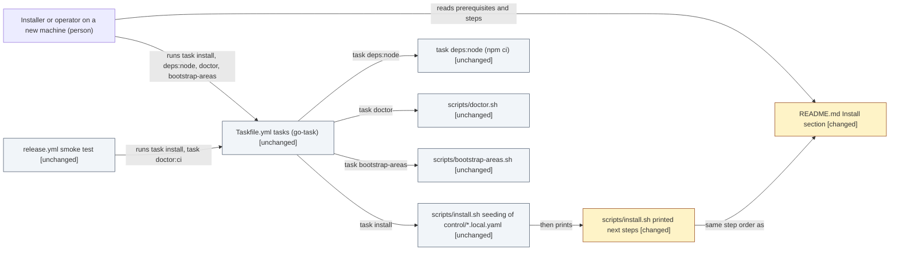

# Design: Root README Install section: use task install / task bootstrap-areas

> Phase: Design | Started: 2026-10-24 | Status: Draft, ready for the Design gate
> Requirements: [`define/index.md`](../define/index.md) · Session history: [`log.md`](../log.md)

## Contents

This design is `index.md` only. The kind has no in-depth path, and no layer with a standard changes, so there is no `solution.md`, no layer file and no `ui-handoff.md`.

## Prior knowledge

- **Read:** the frozen `define/` folder (`index.md`, `requirements.md`, `framing.md`) and this session's `log.md`; [ADR-0001](../../../adr/0001-install-and-update-tooling.md) (go-task is the install entrypoint, and the README must document it as a prerequisite); [ADR-0005](../../../adr/0005-default-areas-taxonomy-and-bootstrap.md) (the areas manifest, `install.sh` seeding it, `bootstrap-areas` needing python3 and PyYAML, the stale-defaults guard); the code: `README.md`, `Taskfile.yml`, `scripts/install.sh`, `scripts/doctor.sh`, `scripts/bootstrap-areas.sh`, `.github/workflows/release.yml`.
- **No construct registry:** there is no `docs/registry/`. ADRs live in `docs/adr/`.
- **Not read:** any past session folder, including `docs/sessions/archive/`. `framing.md` cites an archived session's design decision D13; the citation is taken as given and the folder wasn't opened.

## Classification

- **Primary kind:** Plugin/tooling: the change is to the install tooling's user-facing surface, the README's install instructions for the Taskfile tasks (REQ-001 to REQ-010) and the next steps `scripts/install.sh` prints (REQ-011), with no behaviour change to any task or script.
- **In-depth path:** none yet: dkoenawan/compass-labs#51, see Open questions.

*Confirmed by the operator on 2026-10-24.*

## Scope checklist

| Area | In scope? | Reason |
|---|---|---|
| Documentation (root `README.md` `## Install` section) | in | REQ-001 to REQ-010 all describe this section. |
| Plugin/tooling (`scripts/install.sh` printed next steps) | in | REQ-011 and REQ-007: the printed text gains `task deps:node`. Text only; the `seed_local` calls stay as they are. |
| Plugin/tooling (`Taskfile.yml`, `doctor.sh`, `bootstrap-areas.sh`, `scripts/lib/`) | out | Read only, to keep the README accurate (Define constraint). No behaviour change; doctor's optional checks are #25. |
| Process/workflow | out | The install procedure itself doesn't change. The README now documents the steps the tooling already needs, in the order `install.sh` prints them. |
| Infrastructure / CI | out | The release smoke test runs `task install` then `task doctor:ci`, and doesn't read the printed text. |
| Frontend, backend, database | out | No UI, service or stored data. |
| Visual UI design | out | No screens. |
| Other docs (tutorial, how-to, other README sections) | out | Define non-goal: they already use the task path. |

*Confirmed by the operator on 2026-10-24, as drafted.*

## Context view

*Notation: C4 component view (Plugin/tooling), drawn as a Mermaid `flowchart` with delta styling.*

## Delta list

Each element this design touches has exactly one status. Every visual matches this list.

| Element | Status | DES | Note |
|---|---|---|---|
| `README.md` `## Install` section | changed | DES-001 | Rewritten: prerequisites, then the seven steps in `install.sh`'s order, then the Obsidian line. |
| `scripts/install.sh` printed next steps (the `log` lines after `seed_local`) | changed | DES-002 | Gains `task deps:node` before `task doctor`. |
| `scripts/install.sh` seeding (`seed_local` calls) | unchanged | DES-002 | Same files, same copy-if-absent behaviour. |
| `Taskfile.yml` tasks | unchanged | DES-001 | Source of truth for the task names the README uses. |
| `scripts/doctor.sh` | unchanged | DES-001 | Its checks set the prerequisite list; optional checks are #25. |
| `scripts/bootstrap-areas.sh` | unchanged | DES-001 | Needs python3 and PyYAML (ADR-0005). |
| `.github/workflows/release.yml` smoke test | unchanged | DES-002 | Doesn't read the printed text. |
| Other README sections, tutorial, how-to | unchanged | DES-001 | Define non-goal. |

## Components (DES)

| ID | Component | Covers | Result | Check | Depends on |
|---|---|---|---|---|---|
| DES-001 | Root `README.md`, the `## Install` section (up to `## Framework vs. configuration`) | REQ-001, REQ-002, REQ-003, REQ-004, REQ-005, REQ-006, REQ-007, REQ-008, REQ-009, REQ-010 | The section, as a numbered list with one step per item and each command in its own short code block (D1): **(a)** a prerequisites paragraph before any code block: go-task linking `https://taskfile.dev/installation/` (ADR-0001), Node.js 22.18 or later, Claude Code, python3 with PyYAML for the areas bootstrap; Linux and macOS, and Windows under WSL. **(b)** Steps in this order: clone with the `<this-repo>` placeholder and run `task install`, with a sentence that it creates only missing `control/*.local.yaml` files and never overwrites one, so it is safe to re-run; edit `control/roots.local.yaml` (this machine's `home`, `repos` and `logs` paths, which must exist, and repo aliases); edit `control/estate.local.yaml` (your scheduled jobs, or an empty jobs list); `task deps:node`; `task doctor`, healthy when it reports no failed checks; edit `control/areas.local.yaml` or keep the shipped defaults; `task bootstrap-areas`. **(c)** A last paragraph: open the folder as an Obsidian vault, or use it as plain Markdown files. No `cp` of a `control/` file, no `$EDITOR` line, no direct-script commands, no real names, paths or URLs. | Each of REQ-001 to REQ-009's acceptance criteria holds when the section is read. Every `task <name>` in it is in `Taskfile.yml`. Its step order matches DES-002's printed order line for line (REQ-007). REQ-010: on a fresh clone in a scratch directory, with the prerequisites installed, running the section's commands in order (roots set to existing directories) ends with `task doctor` exiting 0 and 7 notes in `20-areas/` besides `README.md`. | DES-002 |
| DES-002 | `scripts/install.sh`, the "Next steps:" `log` lines only | REQ-011, REQ-007 | The printed next steps as seven numbered steps (D2), a new step 3 `Run 'task deps:node' (or npm ci) to install the pinned Node dependencies (needs Node.js 22.18 or later).`, the old steps 3 to 6 renumbered 4 to 7, and their text otherwise unchanged. The `seed_local` calls, the header comment's behaviour description and the exit behaviour stay as they are. | The diff to `install.sh` touches only the next-steps `log` lines. `bash -n scripts/install.sh` passes. On a fresh clone, `task install` prints `task deps:node` as a step before the step that runs `task doctor`, and seeds the same three files as before. | — |

**Coverage:** all 11 live REQs covered (REQ-001 to REQ-010 by DES-001; REQ-007 also by DES-002; REQ-011 by DES-002). None deferred.

**Implementation order** (from Depends on): DES-002 → DES-001.

## Decisions

No existing ADR is re-decided: ADR-0001 fixes go-task as the entrypoint and requires the prerequisite note, and ADR-0005 fixes the areas manifest and bootstrap. Neither choice below is architecture-level, so neither is flagged ADR.

**D1: Layout of the README steps (no ADR).**

| Option | Pros | Cons |
|---|---|---|
| **A. Numbered list, one step per item, each command in its own short code block (chosen)** | Maps one to one onto `install.sh`'s numbered next steps, so REQ-007's parity is checkable by eye; the edit steps read as instructions rather than shell comments; each step can carry its one-line note (re-run safety, healthy doctor, keep the defaults) | Longer than today's section; not one copy-paste block |
| B. One `bash` code block holding all commands in order, with comments for the edit steps, and prose notes after it | Compact; copy-paste friendly; close to today's shape | The edit steps become comments inside a shell block, which invites pasting the whole block before the files are edited; the notes sit away from their steps; parity with `install.sh` is harder to see |

The operator chose A on 2026-10-24: each step lines up with a step `install.sh` prints, which keeps REQ-007's order checkable by eye, and the edit steps read as instructions rather than shell comments.

**D2: How `install.sh` adds `task deps:node` (no ADR).**

| Option | Pros | Cons |
|---|---|---|
| **A. A new numbered step 3, renumbering the later steps to 4 to 7 (chosen)** | One step per action, like the other lines; matches REQ-011's "as a next step" and the README's step list exactly | Touches four more lines for the renumbering |
| B. Fold it into the existing step 3: "Run 'task deps:node', then 'task doctor' …" | Smallest diff; no renumbering | One step does two things; the README's separate `task deps:node` step no longer lines up with a printed step |

The operator chose A on 2026-10-24: one step per action, as REQ-011 reads ("as a next step"), and the printed list matches the README's steps one for one.

## Principles check

| Item | KISS | YAGNI | SOLID |
|---|---|---|---|
| DES-001 | met: one section, the same order as the tooling | met: only what REQ-001 to REQ-010 ask for | n/a: documentation, not software |
| DES-002 | met: text-only edit | met | SRP met: the script still seeds, then prints; OCP, LSP, ISP, DIP n/a: no types, interfaces or dependencies change |
| D1 (option A) | met | met | n/a: documentation |
| D2 (option A) | met: one step, one line | met | n/a: printed text only |

No *traded off* marks.

**Rejected under YAGNI:**
- A go-task presence check inside `Taskfile.yml` (ADR-0001's "ideally"): Define non-goal, no live REQ.
- Direct-script equivalents (`./scripts/*.sh`) in the README: Define non-goal; the scripts' messages already give them.
- Making `task doctor`'s Node and Claude Code checks optional: deferred to #25.
- A mechanical check that the README and `install.sh` stay in the same order: no live REQ asks for it; REQ-007 is a one-time comparison.
- Edits to the tutorial, the how-to or other README sections: Define non-goal.

## Risks

| Risk | Mitigation |
|---|---|
| The README states something today's tooling doesn't do (a wrong task name, a wrong claim about re-runs). | DES-001's check compares every `task` name against `Taskfile.yml`, and the re-run sentence against `install.sh`'s copy-if-absent seeding. REQ-010's fresh-clone run confirms the whole path. |
| The REQ-010 run fails on a machine without Claude Code or Node, because doctor's non-CI checks require them. | Expected until #25. The README lists both as prerequisites (REQ-002), and the Test phase runs REQ-010 on a machine that has them. |
| A public-repo leak: a real repo URL, a username or an absolute path in the README. | The clone line keeps `<this-repo>`; the roots step describes the keys without example paths from a real machine. Reviewed against the repo's CLAUDE.md rules at the Implement gate. |
| The README and `install.sh` drift apart again later. | Out of scope (see Rejected under YAGNI). This change leaves them identical, so a later change to one shows up as a mismatch on review. |

## Open questions

All design questions resolved: the operator confirmed the classification and the scope checklist and chose D1 and D2, all on 2026-10-24.

- **Kind follow-up:** Plugin/tooling has no in-depth path yet: dkoenawan/compass-labs#51. This design covers it in the all-kinds sections, which is proportionate to Define's short tier.
