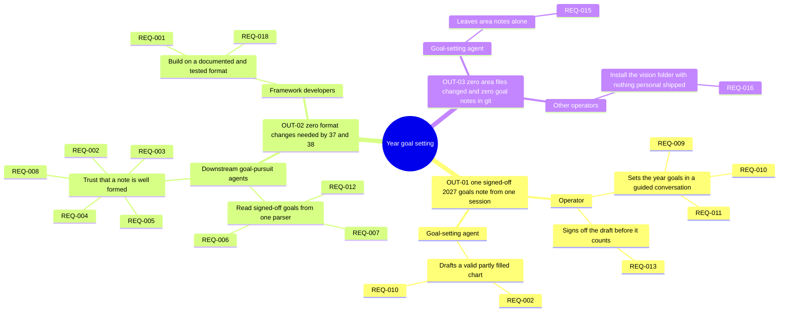
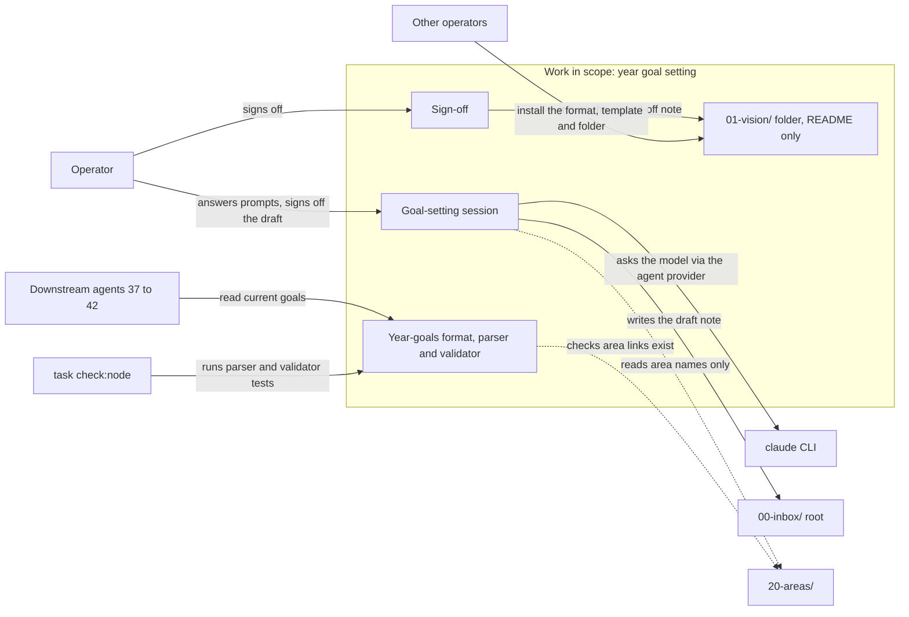
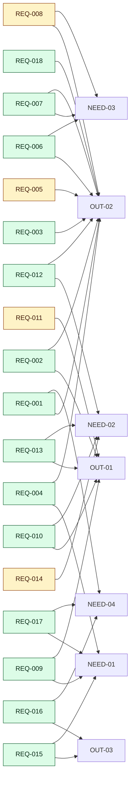

<!-- tier: full -->
# Diagrams: Year goal setting: primary goal as a Mandala Chart, plus secondary goals

> Part of [index](index.md) · Define

## Impact map

## Context diagram

## Traceability

There are 18 requirements and several many-to-many Serves links, so this uses a `flowchart LR` coloured by priority. NEED-01, NEED-02, NEED-03 and NEED-04 appear where a REQ serves them alongside, or instead of, an outcome. Nothing is struck or deferred.

## As-is and to-be

Not required. No existing process changes: today there is no goal-setting process in mycelia to compare against (see [framing.md](framing.md#symptom-and-cause)).
