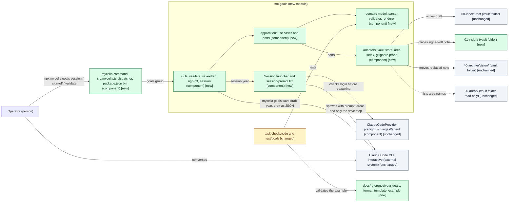
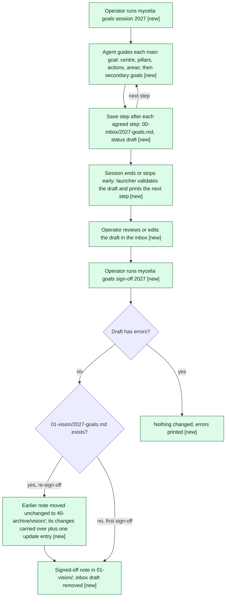

# Design: Year goal setting: primary goal as a Mandala Chart, plus secondary goals

> Phase: Design | Started: 2026-11-03 | Status: Ready for the Design gate
> Requirements: [`define/index.md`](../define/index.md) · Session history: [`log.md`](../log.md)

## Contents

This design has only this file. The primary kind (plugin/tooling) has no in-depth path yet, so there's no `solution.md`, and no layer standard applies (see the scope checklist).

## Prior knowledge

- **Read:**
  - The frozen Define output: `define/index.md`, `requirements.md`, `framing.md`, `quality.md`, `diagrams.md`, and this session's `log.md`.
  - `README.md`, including the project anchor (Mission and Scope as updated at Define), and `CLAUDE.md` (framework/configuration boundary, note format, runner rules).
  - ADRs: `docs/adr/0002-framework-instance-separation.md`, `0006-inbox-capture-ingestion.md` (inbox root vs `capture/`, the `commits: false` exception for gitignored outputs), `0007-typescript-node-runners-and-agent-provider.md` (TypeScript on Node, `task check:node`, the agent-provider seam and its SDK findings, no `.md` committed under `src/` or `test/`).
  - `docs/explanation/notion-capture/overview.md` ("Code structure": the `domain/`, `application/`, `adapters/`, `cli.ts` layering this design reuses).
  - Code and manifests: `Taskfile.yml`, `package.json`, `tsconfig.json`, `eslint.config.js` (the connector layer rule), `.gitignore`, `scripts/install.sh`, `scripts/doctor.sh`, `src/ingest/cli.ts`, `src/ingest/run.ts` (head), `src/ingest/session.ts` (head), `src/ingest/agent/provider.ts`, `src/ingest/agent/claude-code.ts` (header), `src/ingest/prompt.ts` (head: the prompt is kept in a committed `.txt`), `src/ingest/frontmatter.ts`, `src/lib/paths.ts`, `src/lib/claude-bin.ts`, `integration/notion/src/cli.ts`, `integration/notion/src/application/ports.ts`, `integration/notion/src/adapters/notion/template.ts`, and the READMEs of `00-inbox/`, `20-areas/` and `40-archive/`.
  - There's no `docs/registry/`. ADRs live in `docs/adr/`.
- **Not read:** any past session folder, including `docs/sessions/archive/`. Issue #22 itself wasn't read, because this phase has no issue access. Its direction comes from the Notion connector's layering, which the caller named as that direction.

**Stack detected.** Code in this repo is TypeScript on Node 22.18+, run through type stripping, with `yaml`, `zod` and `@anthropic-ai/claude-agent-sdk` already pinned (ADR-0007). This design uses that stack and adds no dependency. No frontend, database or infrastructure stack is involved.

## Classification

- **Primary kind:** Plugin/tooling. The requirements are a parser and validator with a CLI (REQ-002 to REQ-007, REQ-018 to REQ-021), an agent-guided session (REQ-009 to REQ-011, REQ-015), a sign-off command (REQ-012 to REQ-014), and the format docs and vault folder they serve (REQ-001, REQ-016, REQ-017). There's no UI, service or database.
- **In-depth path:** none yet: dkoenawan/compass-labs#51, see Open questions.

The operator raised no objection to this classification on 2026-11-03, and will see it again at the Design gate.

## Scope checklist

| Area | In scope? | Reason |
|---|---|---|
| Plugin/tooling | in | Primary kind. It covers `src/goals/` (parser, validator, renderer, sign-off, current-goals lookup, session launcher) and the new `mycelia` command that runs it. |
| Process/workflow | in | The operator's yearly flow changes: session, draft in the inbox, sign-off, and re-sign-off with archive (REQ-009 to REQ-014). It's small enough for a Mermaid flowchart (see Process view). |
| Documentation | in | Format reference, template and example (REQ-001, REQ-017), `01-vision/README.md` (REQ-016), and the README and CLAUDE.md lines that name the new folder, the note type and the `mycelia` command. |
| Vault structure and gitignore | in | A new `01-vision/` folder that ships a README only, with its content gitignored (REQ-016). |
| Frontend | out | No UI. Notes are read in any Markdown preview (REQ-017). |
| Backend | out | No service or API. The TypeScript code is tooling, covered by the primary kind. |
| Database | out | Plain Markdown in git (anchor Non-goals). |
| Infrastructure | out | Nothing is hosted or deployed. |
| Estate registry | out | The session and sign-off run on demand, so there's no scheduled job to register (Define Non-goals). |
| Taskfile, install and doctor scripts | out | The operator ruled that Taskfile is for installation only (D7). `01-vision/README.md` ships in the clone, so `task install` has nothing to seed, and no requirement needs a doctor check. The existing `ingest-inbox` and `notion:*` targets aren't migrated here. |
| `20-areas/` | out | Read only, for area names and the area-link warning. Nothing here writes to it (REQ-015, the 2026-11-03 ruling). |
| Visual UI design | out | No UI. |

The operator raised no objection to this checklist on 2026-11-03, and will see it again at the Design gate.

## Context view

*Notation: C4 component view (plugin/tooling), drawn as a Mermaid `flowchart` with delta styling.*

This session doesn't build the downstream goal-pursuit features (#37 to #42). They'll import the current-goals lookup and the parser's types from `src/goals/application/` and `src/goals/domain/`, and add their own subcommand groups to `mycelia`.

### Process view

*Notation: process flow, drawn as a Mermaid `flowchart` with delta styling (simple flow, so no BPMN).*

## Delta list

Each element this design touches has exactly one status. Every visual matches this list.

| Element | Status | DES | Note |
|---|---|---|---|
| `src/mycelia.ts` (the `mycelia` dispatcher) | new | DES-007 | The single runtime entry point. `goals` is its first subcommand group. |
| `package.json` (`bin.mycelia`, `scripts.mycelia`) | changed | DES-007 | Install docs change minimally: one README line on running `npx mycelia` (or `npm link` to put `mycelia` on PATH). |
| `src/goals/domain/` (model, parser, validator, renderer, note edits) | new | DES-001, DES-002 | Pure: no I/O imports. |
| `src/goals/application/` (use cases, ports) | new | DES-003 | |
| `src/goals/adapters/` (vault store, area index, gitignore probe, session launcher) | new | DES-004, DES-006 | |
| `src/goals/cli.ts` | new | DES-005 | The `goals` group's composition root, called by the dispatcher. |
| `src/goals/session-prompt.txt` | new | DES-006 | `.txt`, not `.md` (ADR-0007). |
| `eslint.config.js` (layer rule extended to `src/goals/`) | changed | DES-003 | |
| `01-vision/README.md` | new | DES-008 | |
| `.gitignore` (`01-vision/*`, `!01-vision/README.md`) | changed | DES-008 | |
| `docs/reference/year-goals/` (format, template, example) | new | DES-009 | |
| `test/goals/`, `test/mycelia.test.ts` | new | DES-010 | No `.md` fixtures (ADR-0007): inline strings, and the committed example. |
| `README.md` (Layout line, Year goals section, the `npx mycelia` line) | changed | DES-011 | The anchor was already updated at Define. |
| `CLAUDE.md` ("Where things go" row, `type: vision`, runtime commands go through `mycelia`) | changed | DES-011 | |
| `src/ingest/agent/claude-code.ts` (`ClaudeCodeProvider.preflight()`) | unchanged | DES-006 | Reused for the login check before spawning. Not modified. |
| `src/lib/claude-bin.ts` | unchanged | DES-006 | Reused to resolve the CLI. |
| Claude Code CLI | unchanged | DES-006 | Launched interactively. Not modified. |
| `Taskfile.yml` | unchanged | — | No new targets (D7). The existing `ingest-inbox` and `notion:*` targets stay as they are. |
| `00-inbox/` root, `40-archive/` | unchanged | DES-004 | Written to. Folder conventions and READMEs are unchanged. |
| `20-areas/` | unchanged | DES-004 | Read only (REQ-015). |
| `control/estate.example.yaml`, `scripts/install.sh`, `scripts/doctor.sh` | unchanged | — | No scheduled job, and nothing to seed or check. |

## Components (DES)

Each item names the `REQ-*` it covers, the result Implement must produce, the check that shows it's done, and the items it depends on.

| ID | Component | Covers | Result | Check | Depends on |
|---|---|---|---|---|---|
| DES-001 | Model, parser and validator: `src/goals/domain/{model,parse,validate}.ts` | REQ-002, REQ-003, REQ-004, REQ-005, REQ-006, REQ-007, REQ-019, REQ-020, REQ-021 | A `YearGoals` type: year, status, sign-off date or null, main goals in order (each with its centre goal and pillars, each pillar with its actions and areas), secondary goals with their areas, and changes oldest first. `parse(text)` reads the D3 layout and skips anything it doesn't recognise. `validate(text, knownAreas)` returns diagnostics `{severity, where, message}`. Errors are only for the REQ-003 and REQ-007 cases, plus missing or unparseable frontmatter. Warnings are for REQ-005, REQ-019 and REQ-021. The area set is passed in, so the domain does no I/O. | The acceptance cases of REQ-002 to REQ-007 and REQ-019 to REQ-021 pass as unit tests (DES-010). ESLint's domain rule passes. | — |
| DES-002 | Renderer and note edits: `src/goals/domain/render.ts`, `edit.ts` | REQ-010, REQ-011, REQ-013, REQ-014, REQ-017 | `renderDraft(model, dates)` writes a note in the D3 layout with the frontmatter keys `name`, `description`, `type: vision`, `year`, `status: draft`, `created` and `updated`. Sign-off uses text-preserving edits: it sets frontmatter keys (`status`, `signed_off`, `updated`) and merges changes entries into the `## Changes` section, creating the section if it's absent. Identical entries are deduplicated, and every other line stays in place (REQ-020). | Round trip: `parse(renderDraft(parse(example)))` equals `parse(example)` on the documented elements. A sign-off edit on a note with a quarterly breakdown keeps the breakdown byte for byte. | DES-001 |
| DES-003 | Use cases and ports: `src/goals/application/` | REQ-010, REQ-011, REQ-012, REQ-013, REQ-014, REQ-015 | Ports: `VisionVault` (reads and writes the inbox draft, the current note and the archive, and nothing else), `AreaIndex` (area slugs), `IgnoreProbe` and `Clock`. Use cases: `validateNote(path)`; `currentGoals(year)`, which returns the parsed note or `{none, reason}` (REQ-012); `saveDraft(year, model)`, which refuses an empty model or an inbox file for that year that isn't a draft; and `signOff(year)`, following the Process view. Sign-off writes in this order: the new note to a temp file in `01-vision/`, a copy of the earlier note to the archive, a rename of the temp file into place, then removal of the inbox draft. `eslint.config.js` gets the connector's layer rule for `src/goals/{domain,application}/`. | Use-case tests with in-memory ports cover the acceptance cases of REQ-012, REQ-013 and REQ-014, and the order of writes. ESLint fails if `application/` imports `adapters/`. | DES-001, DES-002 |
| DES-004 | Filesystem adapters: `src/goals/adapters/{vault,areas,ignore}.ts` | REQ-005, REQ-015, REQ-016 | `FsVisionVault` writes only `00-inbox/<year>-goals.md`, `01-vision/<year>-goals.md` (and its temp file) and `40-archive/vision/<year>-goals-replaced-<date>.md` (D6). It creates the archive file exclusively. `FsAreaIndex` lists the `20-areas/*.md` stems and only reads. `GitIgnoreProbe` checks with `git check-ignore` that each of those paths is ignored before any write, as the ingester does. | An adapter test against a temp vault: after a save step and two sign-offs, a checksum of `20-areas/` is unchanged and every written path is reported as ignored. | DES-003 |
| DES-005 | `goals` command group: `src/goals/cli.ts` | REQ-003, REQ-010, REQ-013, REQ-014 | The group's composition root, exporting `run(args): Promise<number>` for the dispatcher. Subcommands: `validate <path>` prints each diagnostic with its location and exits 0 with no errors, 1 with errors, or 2 for a usage error or unreadable file. `save-draft <year>` reads the draft JSON on stdin and checks it with `zod`. `sign-off <year>` prints warnings and refuses on errors, changing nothing. `session <year> [--continue]` is DES-006. | Running each subcommand on a temp vault gives the exit codes and files above. | DES-003, DES-004 |
| DES-006 | Session launcher and prompt: `src/goals/adapters/session.ts`, `src/goals/session-prompt.txt` | REQ-009, REQ-010, REQ-011, REQ-015 | `mycelia goals session <year>` does five things in order. (1) Checks the year. (2) Resolves `claude` (`src/lib/claude-bin.ts`) and runs `ClaudeCodeProvider.preflight()` (Agent SDK and `claude auth status`), so a missing or logged-out CLI fails before anything is written. (3) Lists the areas. (4) Refuses if `00-inbox/<year>-goals.md` exists, unless `--continue` is given, in which case it passes that draft to the agent as the starting point. (5) Spawns interactive Claude Code with the prompt (year, areas, existing draft) and a tool set restricted to running `mycelia goals save-draft <year>`. That save step is the agent's only write path (D1, D2). The prompt sets the REQ-009 order, offers the existing areas, and has the agent save after each agreed step, so stopping early keeps the last step (REQ-011). When Claude Code exits, the launcher validates the draft and prints the result and the sign-off command, or says no draft was written. A spike against the installed CLI fixes the exact CLI flags, and the launcher's header records them, as ADR-0007's spike did. | Spike notes are in the header. A launcher test with a fake spawner and a fake preflight checks the arguments, the refusal and the post-exit validation. A manual run for 2027 meets the acceptance of REQ-009 and REQ-011 (recorded in Test). | DES-005 |
| DES-007 | The `mycelia` entry point: `src/mycelia.ts`, `package.json` | REQ-003, REQ-009, REQ-010, REQ-013 | A small dispatcher, `mycelia <group> <command> [args]`. It holds a map from group name to a lazily imported `run(args)`, with `goals` (DES-005) as the only group for now. `mycelia`, `mycelia help` and an unknown group print the groups and exit 2. It sets `process.exitCode` from the group's return value and catches unexpected errors as `src/ingest/cli.ts` does. It starts with `#!/usr/bin/env node`. `package.json` gains `"bin": {"mycelia": "src/mycelia.ts"}` and a `"mycelia"` script, so it runs as `npx mycelia …` in the repo, as `npm run mycelia -- …`, or as `mycelia …` after `npm link`. | `npx mycelia goals validate <example>` exits 0 in a fresh clone after `task deps:node`. A dispatcher test covers an unknown group and the exit-code passthrough. | DES-005, DES-006 |
| DES-008 | `01-vision/README.md` and `.gitignore` | REQ-016 | A README in the vault note format. It says what belongs in `01-vision/` (the signed-off year-goals notes, one per year), how notes get there (by sign-off only), and that the content stays local. `.gitignore` gains `01-vision/*` and `!01-vision/README.md`. | REQ-016's acceptance: `git ls-files 01-vision/` lists only the README, and neither a note in `01-vision/` nor a draft in `00-inbox/` shows in `git status --porcelain`. | — |
| DES-009 | Format reference, template and example: `docs/reference/year-goals/{format.md,template.md,example-2027-goals.md}` | REQ-001, REQ-017 | `format.md` documents every element of REQ-002, REQ-004, REQ-007 and REQ-020, the frontmatter, the D3 layout, each error and warning, the `mycelia goals` commands and their exit codes, and the file locations. `template.md` is a valid note with placeholder text. The example matches REQ-001 and REQ-006: 2 main goals with 8 and 3 pillars, one pillar with 8 actions, 2 secondary goals, 1 change, signed off 2026-12-20. It uses only default area slugs from `control/areas.example.yaml`. | The validator gives 0 errors and 0 warnings on the example with the default area set, and 0 errors on the template (DES-010). The example shows every element in GitHub's preview and in Obsidian without plugins (REQ-017, checked in Test). | DES-001 |
| DES-010 | Tests: `test/goals/*.test.ts`, `test/mycelia.test.ts` | REQ-018 | One named test for each item REQ-018 lists, plus the REQ-001 and REQ-006 example checks, the DES-002 round trip, and the DES-003, DES-004, DES-006 and DES-007 checks. Fixtures are inline strings, not `.md` files. | `task check:node` passes. Turning the more-than-3 warning into an error makes at least one test fail. | DES-001 to DES-007, DES-009 |
| DES-011 | Framework docs: `README.md`, `CLAUDE.md` | REQ-001, REQ-016 | README: `01-vision/` in Layout, a short Year goals section (`npx mycelia goals session <year>`, `… sign-off <year>`, `… validate <path>`, linking the format reference), and one line in Install saying runtime commands run as `npx mycelia` (or `mycelia` after `npm link`). CLAUDE.md: a `01-vision/` row in "Where things go", `vision` added to the note format's `type` values, and one line under "Writing runners" saying that new runtime commands are `mycelia` subcommand groups while Taskfile is for installation. | Both files name `01-vision/` and the `mycelia` command and link the format reference. No `task goals:*` appears anywhere. No real names or absolute paths. | DES-007, DES-008, DES-009 |

**Coverage:** all 20 live REQs are covered (REQ-001 to REQ-021, with REQ-008 struck and #46 deferred).

| Requirement | Covered by |
|---|---|
| REQ-001 | DES-009, DES-011 |
| REQ-002 | DES-001 |
| REQ-003 | DES-001, DES-005, DES-007 |
| REQ-004 to REQ-007 | DES-001 |
| REQ-009 | DES-006, DES-007 |
| REQ-010 | DES-002, DES-003, DES-006, DES-007 |
| REQ-011 | DES-002, DES-003, DES-006 |
| REQ-012 | DES-003 |
| REQ-013 | DES-002, DES-003, DES-005, DES-007 |
| REQ-014 | DES-002, DES-003, DES-005 |
| REQ-015 | DES-003, DES-004, DES-006 |
| REQ-016 | DES-004, DES-008, DES-011 |
| REQ-017 | DES-002, DES-009 |
| REQ-018 | DES-010 |
| REQ-019 to REQ-021 | DES-001 |

**Implementation order** (from Depends on):

1. DES-001 and DES-008
2. DES-002 and DES-009
3. DES-003
4. DES-004
5. DES-005
6. DES-006
7. DES-007
8. DES-011
9. DES-010

Tests are written alongside each item, and DES-010's check closes them.

## Decisions

**D1: How the goal-setting session is invoked (ADR: an interactive agent session outside the agent-provider seam).**

| Option | Pros | Cons |
|---|---|---|
| **A. `mycelia goals session <year>`: a TypeScript launcher that starts interactive Claude Code with a committed prompt and only the save step as a tool (chosen)** | It's a true multi-turn conversation in Claude Code's own interface, with no chat loop to build. The launcher fixes the prompt, the area list and the tools in code, so the agent can't write anywhere else (REQ-015). Deterministic checks run before the conversation (login, an existing draft) and after it (validation). It reuses `ClaudeCodeProvider.preflight()` from the Agent SDK provider for the login check. | It depends on the Claude Code CLI directly for the conversation, outside ADR-0007's `AgentProvider` seam, which is one-shot and non-interactive. CLI flags can change between versions (mitigated by a spike and a header note). |
| B. A Claude Code project skill, run as `/year-goals 2027` in any Claude Code session in the vault | Least code, and it works in any session the operator already has open. | The session has every tool and the operator's settings, so REQ-015 rests on instructions alone. There's no deterministic step before or after. |
| C. A TypeScript chat loop that calls `AgentProvider.run()`, through the Agent SDK, once per turn | It stays inside the provider seam (ADR-0007, #19), and it can be tested with a fake provider. | It means building a chat interface within a one-week appetite. The provider has no multi-turn call, so every turn replays the transcript. The conversation would be worse than Claude Code's. |

The operator chose A on 2026-11-03 and asked that it be invoked through the `mycelia` command (D7), not Taskfile. The Agent SDK fits where the launcher needs a programmatic check, the login preflight. It doesn't provide an interactive terminal conversation, so the conversation itself runs in the Claude Code CLI.

**D2: How the draft note is written (no ADR).**

| Option | Pros | Cons |
|---|---|---|
| **A. The agent passes a structured draft (JSON) to `mycelia goals save-draft <year>`. The command checks it, renders the note and writes only `00-inbox/<year>-goals.md`. The agent has no file-writing tool (chosen)** | Every draft is valid by construction (REQ-010, REQ-011). The only write path is tested code (REQ-015). Saving after each step means an early stop keeps its work. | It needs a JSON shape and a renderer. The agent can't add free-form extras, though the operator can by editing the draft. |
| B. The agent writes the Markdown itself with Claude Code's Write tool, then runs the validator and fixes any errors | Least code, and the agent can write any extra content. | Validity depends on the agent getting it right before the session ends, and an early stop can leave an invalid draft. Confining writes needs path-scoped permission rules. |
| C. As A, but serve the save step to Claude Code as an MCP tool | Typed tool calls with a schema, and no shell. | An MCP server to build and configure on every launch. |

The operator chose A on 2026-11-03.

**D3: How a Mandala Chart is laid out in Markdown (no ADR).**

| Option | Pros | Cons |
|---|---|---|
| **A. Headings and lists (chosen).** Each main goal is `## Main goal: <centre>`. Each pillar is `### Pillar: <name>`, with an `Areas: [[a]], [[b]]` line and its actions as top-level list items. `## Secondary goals` is a list (`- <goal> Areas: [[a]]`), and `## Changes` is a list of `- YYYY-MM-DD: <text>` entries. | Readable in any preview (REQ-017). A partly filled chart is natural. Extra content such as a quarterly breakdown fits as nested items, paragraphs or other headings, and the parser skips it (REQ-020). Clean diffs and a simple parser. | It doesn't look like the 9 × 9 grid. A mistyped heading prefix is skipped silently (see Risks). |
| B. A 9 × 9 grid table per main goal | Looks like a Mandala Chart. | 81 cells, mostly empty for a partial chart. No natural place for areas or extra content. Wikilinks in tables need escaping. Hard to edit and to parse. |
| C. The whole structure in YAML frontmatter, with a free body | Trivial to parse. | Nested YAML doesn't show as readable text in previews (REQ-017). Obsidian's Properties editor rewrites frontmatter when it's edited (ADR-0002's finding). |

The operator raised no objection to A on 2026-11-03.

**D4: How sign-off happens (no ADR).**

| Option | Pros | Cons |
|---|---|---|
| **A. A separate deterministic command, `mycelia goals sign-off <year>` (chosen)** | Signing off is a deliberate, separate act (NEED-02). Code does the moves and merges the changes, so REQ-013, REQ-014 and REQ-015 are tested without a model. | One more command to remember. The session prints it at the end. |
| B. The agent offers sign-off at the end of the session and does it | One flow. | Drafting the goals and committing to them blur together. A model does the file moves and merges the changes, which is hard to test. |
| C. By hand: the operator edits the status and moves the file, then the validator checks it | No code. | REQ-013 and REQ-014 say the framework does it. Carrying changes over and archiving by hand is error-prone. |

The operator chose A on 2026-11-03.

**D5: Where the code lives and how it's structured (no ADR: follows the Notion connector's layering).**

| Option | Pros | Cons |
|---|---|---|
| **A. `src/goals/` in layers, as `integration/notion/src/` is: a pure `domain/`, `application/` with ports, `adapters/`, and `cli.ts` as the composition root, with the ESLint layer rule extended to it (chosen)** | Follows the repo's newest structure and the #22 direction. #37 to #42 import the pure domain. Use cases can be tested with in-memory ports. | More files than a flat module, plus one ESLint config change. |
| B. A flat module like `src/ingest/` | Fewer files, and it matches the ingester. | No enforced boundary between pure parsing and file I/O, which downstream features would inherit. |

The operator raised no objection to A on 2026-11-03.

**D6: Smaller format and file choices (no ADR).** The operator raised no objection to the recommended column on 2026-11-03.

| Choice | Chosen | Alternative |
|---|---|---|
| Note `type` | A new `type: vision`, added to CLAUDE.md's list. | Reuse `type: reference`. That avoids a convention change, but goals would look like reference material to other agents. |
| File names | The draft is `00-inbox/<year>-goals.md`, and the current goals are `01-vision/<year>-goals.md`. | A timestamped draft name, which allows several drafts per year, but REQ-010 expects one. |
| Replaced note in the archive | `40-archive/vision/<year>-goals-replaced-<date>.md`, with its content unchanged byte for byte (REQ-014). Its `name:` no longer matches its file name, which is an accepted exception for archived goals. | A dated folder, `40-archive/vision/<date>/<year>-goals.md`. Name and file name stay equal, but `[[2027-goals]]` becomes ambiguous in Obsidian. |
| A draft for the year already exists | The session refuses to start. `--continue` starts from that draft and overwrites it. | Always continue silently, which risks losing hand edits, or archive the old draft first, which means more writes. |
| Where the format docs live | `docs/reference/year-goals/`. Nothing `.md` goes under `src/`, and `01-vision/` holds only its README. | `control/`, beside the other committed templates. But `control/` holds YAML configuration, not notes. |

**D7: How runtime commands are invoked (ADR: Taskfile for installation only; runtime commands through one `mycelia` TypeScript entry point).**

| Option | Pros | Cons |
|---|---|---|
| **A. One `mycelia` entry point (`package.json` `bin`, `src/mycelia.ts`) with subcommand groups, `goals` first (chosen)** | One discoverable command for every runtime feature. It's TypeScript, so dispatch, arguments and exit codes are tested under `task check:node`. Later features add a group, not a new wiring file. | A second way to run things until the existing `ingest-inbox` and `notion:*` task targets move over. `npx` or `npm link` is needed to run it. |
| B. `task goals:*` targets, in the style of `ingest-inbox` | Matches the existing runtime targets. | Contrary to the operator's ruling that Taskfile is for installation only. go-task hides the command's exit codes, reporting 201 for any failure (README known issues). |
| C. One `bin` per feature (`mycelia-goals`, …) | No dispatcher. | The number of commands grows with every feature, with no shared help or error handling. |

The operator ruled A on 2026-11-03: "Taskfile is for installation only, for mycelia run task can we use typescript." This is architecture-level, so it's flagged for an ADR at Close. It refines how ADR-0001 and ADR-0007 are applied, and changes neither.

## Principles check

| Item | KISS | YAGNI | SOLID |
|---|---|---|---|
| DES-001 | met | met | SRP met: parse and validate are separate functions. OCP met. LSP n/a: no subtypes. ISP met. DIP met: the areas are passed in, with no I/O. |
| DES-002 | met | met: sign-off needs text-preserving edits to keep extra content (REQ-020) | SRP met. OCP met. LSP n/a. ISP met. DIP met. |
| DES-003 | met | met | SRP met: one use case per operation. OCP met. LSP met: in-memory and filesystem ports are interchangeable. ISP met: four narrow ports. DIP met. |
| DES-004 | met | met | SRP met. OCP met. LSP met. ISP met. DIP met. |
| DES-005 | met: one subcommand per operation | met | SRP met. OCP met. LSP n/a. ISP n/a. DIP met: the only place that builds adapters. |
| DES-006 | met | met | SRP met. OCP met. LSP n/a. ISP n/a. DIP traded off: the launcher depends on the Claude Code CLI directly for the conversation, because the `AgentProvider` seam is one-shot (D1). Accepted by the operator on 2026-11-03. |
| DES-007 | met: a map of groups, no framework | met: one group now, and the operator ruled the entry point the pattern for later features | SRP met: it dispatches and nothing else. OCP met: a group is added without changing the dispatch. LSP met: every group exposes the same `run(args)`. ISP met. DIP met. |
| DES-008 | met | met | n/a: documentation and ignore rules |
| DES-009 | met | met | n/a: documentation |
| DES-010 | met | met | n/a: tests |
| DES-011 | met | met | n/a: documentation |
| D1 (A) | met | met | DIP traded off, as for DES-006. Accepted by the operator. |
| D2 (A) | met | met | met |
| D3 (A) | met | met | n/a: a document format |
| D4 (A) | met | met | met |
| D5 (A) | traded off: more files than a flat module, in exchange for a boundary that downstream features rely on. Accepted by the operator on 2026-11-03. | met | met |
| D6 | met | met | n/a: naming and placement |
| D7 (A) | met | met | met, as for DES-007 |

**Rejected under YAGNI:**
- **A `mycelia goals current` command.** REQ-012 needs the lookup as a function for downstream agents, not as a command.
- **Migrating `ingest-inbox` and `notion:*` to `mycelia` subcommands.** No live requirement here needs it, and the operator put it out of scope.
- **A multi-turn method on `AgentProvider`.** No live requirement needs another provider for the session (#19 owns providers).
- **A doctor check for `01-vision/`, or an install step.** The README ships with the clone, and `.gitignore` meets REQ-016.
- **A format version field in the note.** Nothing reads two versions yet.
- **Warnings for unrecognised headings.** REQ-020 asks for tolerance, and a quarterly breakdown would warn on every run.
- **A how-to guide and an explanation doc.** REQ-001 asks for the format docs, template and example, and the README section covers the commands.
- **An overview table (3 × 3 or 9 × 9) rendered beside the lists.** The lists meet REQ-017.
- **The amendment flow (#46), a goal lifecycle, the quarterly breakdown (#38), and an estate registry entry.** All out of scope per Define.

## Risks

| Risk | Mitigation |
|---|---|
| The Claude Code CLI flags for the interactive launch (tool restriction, prompt injection) change between versions. | A spike in Implement pins the flags against the installed CLI and records them in the launcher's header, as ADR-0007's spike did. The SDK preflight fails fast if the CLI is missing or logged out. |
| `npx mycelia` doesn't resolve the repo's own `bin`, or Node won't strip types for the `bin` path. | DES-007's check runs `npx mycelia` in a fresh clone. If it fails, the documented form becomes `npm run mycelia -- …`, which needs no linking, and `npm link` stays the optional way to get a bare `mycelia`. Either way, the README gets one line. |
| The runtime commands are split between `mycelia` (new) and the `ingest-inbox` and `notion:*` task targets, which predate the ruling. | The split is stated in CLAUDE.md and the README. `mycelia` is the pattern to move those targets to later, as a follow-up and not in this session (see Open questions). |
| A mistyped heading such as `## Main gaol: …` is skipped as extra content, and the goal silently drops out of the parsed result. | `format.md` documents the heading prefixes. `validate` prints a summary of what it found (main goals, pillars, secondary goals), so a missing goal shows. A note with no goal at all is already an error (REQ-003). |
| The example note uses the default areas, so validating it in a vault that lacks one of them gives a warning. | The REQ-001 test validates against the default area set from `control/areas.example.yaml`, and `format.md` says the example assumes the default areas. |
| Sign-off crashes between the archive copy and the final rename, or between the rename and removing the inbox draft. | The write order in DES-003 means the earlier note is always either current or archived. Re-running sign-off is safe: at worst it leaves an extra archive copy and one extra changes entry, and loses nothing. |
| `--continue` overwrites hand edits the operator made to a draft. | The flag is explicit, and before spawning, the launcher says the draft will be rewritten from what the session agrees. |
| A downstream agent mistakes a note under `docs/reference/year-goals/` for the operator's goals. | Downstream reads go through `currentGoals(year)`, which reads only `01-vision/`. The example's file name starts with `example-`. |
| A goals note is committed by accident. | `.gitignore` covers `00-inbox/`, `01-vision/` and `40-archive/`, and the adapters refuse to write to any path that `git check-ignore` doesn't report as ignored. |

## Open questions

All questions are resolved. The operator chose D1, D2, D4 and D7. They raised no objection to the classification, the scope checklist, D3, D5, D6, or the two *traded off* marks (DIP on the launcher, KISS on the layering), and they'll see all of them again at the Design gate.

Open items and follow-ups:

- **The kind's follow-up:** plugin/tooling has no in-depth path yet (dkoenawan/compass-labs#51). Process/workflow, a secondary area in scope here, has none either (dkoenawan/compass-labs#49).
- **ADRs flagged for Close:**
  - D1: an interactive agent session launched outside the `AgentProvider` seam.
  - D7: Taskfile is for installation only, and runtime commands go through the `mycelia` entry point.
- **Follow-up, not this session:** move `ingest-inbox`, `ingest-inbox:preflight` and `notion:*` from Taskfile to `mycelia` subcommand groups. They predate the D7 ruling.
